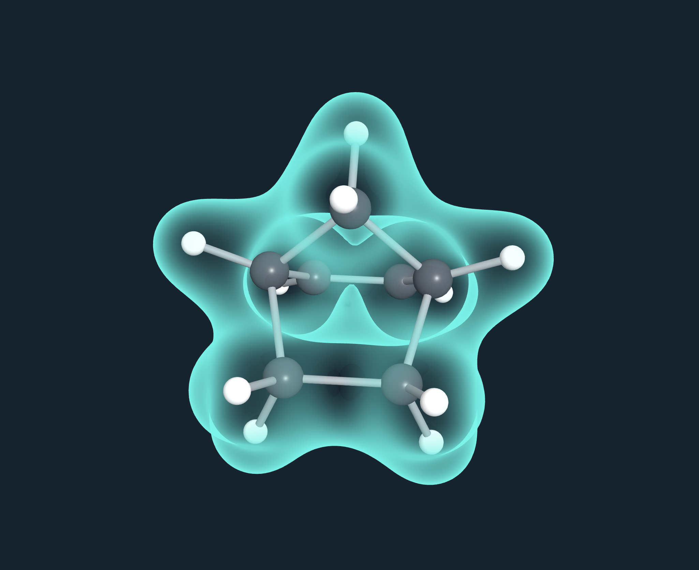

# EigenVista

Version **0.10.3** prevents Save from overtaking pending inspection edits, adds
an explicit replacement option for converter/AI exports to the tested Mac ExFAT
volume, and includes the optional Accessible elements palette. It retains
automatic field-plane updates, live molecular-surface progress, visible atom
picking, smooth view-relative lighting and
[allocation-driven workloads](docs/allocation-policy.md).

Release qualification and delivery are tracked in
[#103](https://github.com/uvar-apps/eigenvista/issues/103). See the
[0.10.3 notes](docs/releases/0.10.3.md) and [living handoff](docs/handoff.md)
for package identity and publication state. Historical releases keep their
original contents.

**Explore molecular orbitals, electron density and large molecular structures.**

EigenVista is a molecular and quantum chemistry viewer. Inspect the shape of an
orbital, look inside a density surface with a custom shader, or reveal the folds
of a large protein complex with ambient occlusion.

**Version 0.10.3 — experimental development preview for Apple Silicon Macs.**

**[Download 0.10.3 for Mac](https://github.com/uvar-apps/eigenvista/releases/tag/v0.10.3)** ·
[Installation](https://uvar-apps.github.io/eigenvista/install.html) ·
[Manual](https://uvar-apps.github.io/eigenvista/reference.html) ·
[Tutorials](https://uvar-apps.github.io/eigenvista/tutorials.html) ·
[Gallery](https://uvar-apps.github.io/eigenvista/gallery.html)

[](https://uvar-apps.github.io/eigenvista/surface-shaders.html)

*A 17-atom molecule inside its electron-density surface: 0.04 electrons/bohr³,
sampled on a 256³ grid. An X-ray surface shader reveals the framework beneath.
[Make this view](https://uvar-apps.github.io/eigenvista/surface-shaders.html).*

**[Watch the 30-second shader demo](https://uvar-apps.github.io/eigenvista/#shader-demo)** —
the same density surface, from solid to X-ray transparency and live clipping,
with English narration and synchronized captions.

## What you can explore

- **Orbitals and electron density.** Browse orbital energies, occupations and
  spin, select the orbitals you want, then generate signed isosurfaces or try
  ray-cast and volume previews. Calculations run in the background with progress
  and cancellation.
- **Your own surface appearance.** Load custom GLSL shaders and adjust their
  parameters live. Start with the supplied X-ray and clipping presets to look
  inside a molecular envelope without regenerating its mesh.
- **Depth in dense molecules.** Use matte Lambert shading with screen-space
  ambient occlusion to reveal contacts and cavities. The optional
  [MatterViz Pastel palette](palettes/matterviz-pastel.json) is recommended for
  the best ambient-occlusion results.
- **Biological structure.** Color by chain, entity or deposited secondary
  structure; isolate components; combine atomic views with backbone traces,
  tubes, ribbons and strand-arrow cartoons.
- **AI-enabled viewing.** Ask Codex, Claude Code, Pi, OpenCode or another local
  agent to explore molecules and export figures. The Mac app includes its
  connection helper and setup instructions; no source checkout is needed.
- **Views worth keeping.** Save molecular data and generated meshes together in
  an `.eigenvista` file. Export the current view as a PNG, including a transparent
  background for figures and slides.

Open **Molden**, **Gaussian cube**, **PDB**, **mmCIF / BinaryCIF**, **XYZ**, and
native **`.eigenvista`** files. Display bonds are computed automatically.
The [file reference](https://uvar-apps.github.io/eigenvista/reference-files.html)
describes the supported profiles; the standalone converter supports the same
imports.

## A wider workspace and scientific inspection

EigenVista 0.10.3 uses a single resizable tools pane, with four tabs:
**Molecule**, **Fields**, **Surfaces** and **Appearance**. Put it on either side,
widen it to let widgets flow into two columns, or hide it to reclaim the view.
Zen mode removes the surrounding interface; fullscreen is a separate action.
Existing collapsible, draggable widgets and camera/export controls stay familiar.

Scientific inspection is available through the GUI and the AI connector:

- Ordered atom selections, distance/angle/torsion measurements, labels, named
  sets and individual-ligand neighborhoods.
- Solvent-excluded and solvent-accessible molecular surfaces (SES/SAS), with
  explicit radii/probe/spacing and cached native-file geometry.
- Quantitative field meaning/units, probes, planes/contours, line profiles,
  numerical keys, CSV and annotated/transparent PNG output.

To draw an orbital on a plane, open **Fields → Quantitative field inspection**,
choose an orbital and **Plane / contours**, then **Create plane**. The color bar
reports signed orbital amplitude; choose an electron-density field for density.
Read the [user guide](docs/user-guide.md) for probes, contours and line profiles.

These additions are included in the **0.10.3 Mac download** and its bundled AI
connector. Read the [0.10.3 release notes](docs/releases/0.10.3.md).
The [workspace design](docs/design/2026-11-17-simple-workspace-pane.md)
records the approved layout; [handoff](docs/handoff.md) records current
validation and delivery. The local `v0.9.0` tag remains the earlier scientific
inspection checkpoint.

## Start here

Version **0.10.3** is an experimental **Apple Silicon Mac** preview.
The download includes the application, examples, shader presets, palettes,
converter and a ready-to-use AI connector. It is ad-hoc signed and not Apple-notarized; follow the
[installation guide](https://uvar-apps.github.io/eigenvista/install.html) for the
first launch. Linux and Windows packages are not available yet.

- [Explore orbitals and density](https://uvar-apps.github.io/eigenvista/tutorials-orbitals.html)
  with a supplied Molden calculation.
- [Try X-ray and clipping shaders](https://uvar-apps.github.io/eigenvista/surface-shaders.html)
  on the density surface pictured above.
- [Reveal a large molecular complex](https://uvar-apps.github.io/eigenvista/tutorials-ao.html)
  with ambient occlusion and the Pastel palette.
- [Read the full manual](https://uvar-apps.github.io/eigenvista/reference.html)
  or [report a problem](https://github.com/uvar-apps/eigenvista/issues).

## History

EigenVista is a modern rewrite of **Molekel**, the molecular visualization
application developed by **Ugo Varetto from 2006 to 2010**. That work brought
together molecular structures, quantum chemistry surfaces and programmable
shaders. EigenVista carries the project forward with a new implementation and
name.

Explore the [original Molekel source](https://github.com/ugovaretto/molekel) and
the [original Molekel website](https://ugovaretto.github.io/molekel/), with its
documentation and gallery.

## Cite EigenVista

Varetto, U. (2026). *EigenVista: molecular and quantum chemistry visualization*
(Version 0.10.3) [Computer software].
[DOI: 10.5281/zenodo.24391046](https://doi.org/10.5281/zenodo.24391046).

Machine-readable metadata is in [CITATION.cff](CITATION.cff). The
[concept DOI 10.5281/zenodo.24246123](https://doi.org/10.5281/zenodo.24246123)
identifies EigenVista across all versions. The historical 0.10.1 DOI remains
[10.5281/zenodo.24328295](https://doi.org/10.5281/zenodo.24328295).
The historical 0.10.0 DOI remains
[10.5281/zenodo.24302658](https://doi.org/10.5281/zenodo.24302658), and the 0.8.0 DOI
remains [10.5281/zenodo.24273137](https://doi.org/10.5281/zenodo.24273137).
Use the citation for the version used in your work.

## Author and copyright

Author: Ugo Varetto

Copyright (c) 2026 - Ugo Varetto

EigenVista is licensed under [GPL-2.0-or-later](LICENSE).

## Development status and history

A clean Rust scientific core with a React/Three.js interface, shared by a Tauri macOS application and the browser. This directory is independent of the legacy implementation. No legacy source is copied or built, and no C++ is used in the application.

The current implementation is maintained in
[`uvar-apps/eigenvista`](https://github.com/uvar-apps/eigenvista). Its code was
moved from the rewrite's `next/` directory to this repository's root; the
[migration record](docs/migration.md) describes that repository extraction.
Legacy application code is not included.
The icon and logo are unchanged. New documents use
`.eigenvista`; existing `.molekel` preview documents still open with their
scientific data and saved meshes. New saves use EigenVista format identifiers
and are not guaranteed readable by older Molekel builds, even when saved with
a `.molekel` filename. See the [native profile](docs/preview-format.md).

**Current release:** version **0.10.3**, a development preview, combines the wider
workspace with the scientific-inspection workflows above. See
[0.10.3 notes](docs/releases/0.10.3.md) and
[current status](docs/status.md) for qualification and delivery.

Version **0.8.0** introduced AI-enabled viewing through an external local
agent, with a prebuilt connector inside the Apple Silicon application. Ask Codex,
Claude Code, Pi, OpenCode or another terminal-capable agent to explore orbitals,
load palettes, prepare molecular views and export figures. The normal GUI remains
the same; no embedded console or model account is required.
The 0.8.0 release is published with rebuilt Apple Silicon redistributables,
release notes, checksum and build information. All relevant local checks,
extracted-app workflows and downloaded release assets passed verification.
This remains an experimental development preview, not v1 or completion of the
M0–M7 plan. See [implementation status](docs/status.md#source-version-080) and
[0.8.0 release notes](docs/releases/0.8.0.md) for qualification and delivery.
Earlier releases retain their original source and artifacts.

Earlier releases added native close/quit protection, correct Molden limits,
then-hosted verification, and reduced Molden-import/surface-publication work
(#30–#34). All relevant checks now run locally before pushing; hosted jobs are
optional by explicit request.
They also added the bounded Vite maintenance update, authentic native-file
regressions, typed numerical encoding and collapsible sidebar sections.
Indexed meshes remain a qualification experiment; production generation is
unchanged. Version 0.5.14 includes the volume opacity/quality fix
[#55](https://github.com/uvar-apps/eigenvista/issues/55), with consistent
visibility and representative depth across sampling qualities. See the
[0.5.14 release notes](docs/releases/0.5.14.md) and
[visibility/depth decision](docs/design/2026-11-13-volume-visibility.md).
Version 0.5.15 adds [#52 sidebar reordering](docs/design/2026-11-13-sidebar-reordering.md)
with native drag, keyboard and tap controls, remembered profile order and
preserved control/calculation state. See the [0.5.15 release notes](docs/releases/0.5.15.md).

Version 0.6.0 adds optional molecular ambient occlusion for dense
structures ([#59](https://github.com/uvar-apps/eigenvista/issues/59)): matte Lambert
shading, broad fold/cavity depth cues and an automatic radius based on molecular
size. Read the [0.6.0 release notes](docs/releases/0.6.0.md) and
[AO decision](docs/design/2026-11-14-molecular-ambient-occlusion.md).
The published 0.6.0 package includes AO; older 0.5.15 packages predate it.

Version 0.7.0 adds selected biological identity, chain/entity colors, component
selection and mixed views, and protein traces, tubes, ribbons and cartoons.
The work for [#62–#66](https://github.com/uvar-apps/eigenvista/issues/62) merged
through [PR #67](https://github.com/uvar-apps/eigenvista/pull/67). Secondary
assignments are deposited only; missing identity or assignments are not invented.
See the [user guide](docs/user-guide.md#biological-structure-views) for controls
and the [native profile](docs/preview-format.md#biological-structure-capability)
for the optional capability required by new biological documents. The published
0.6.0 app/ZIP does not include these views. Updating source versions does not
update an installed app or an existing archive.

## Documentation for contributors

Version 0.7.2 adds a scene **Background color** picker/reset and a separate
**Export image with transparent background** action (#73/#74). Normal image
export uses the chosen opaque background. Optional Muted/Pastel JSON palettes
load through **Atom colours → Colours file…**; source files are in `palettes/`
and the tester ZIP includes `Palettes/` with attribution and license.
See the [user guide](docs/user-guide.md#moving-and-inspecting-the-scene) for controls.

Version 0.7.1 renames the **Document** sidebar section to **Molecular data**
([#70](https://github.com/uvar-apps/eigenvista/issues/70)). Its controls and saved
documents are unchanged; the same internal panel IDs preserve existing ordering,
expansion preferences and control state.

- **Using the application:** [User guide](docs/user-guide.md), including Mac
  installation, supported files, controls, surfaces, saving, and troubleshooting.
- **Building or running from source:** [Development guide](docs/development.md).
- **Using Codex, Claude Code, Pi, OpenCode or another local agent:**
  [Connector installation and user guide](docs/ai-connector.md), including a
  copyable setup prompt for the installed app and its bundled prebuilt helper.
  Version 0.8.0 bundles the helper, launcher, examples and palettes.
  No source checkout or compiler is needed to use the package.
  The [API reference](docs/application-control.md) covers methods and file grants;
  the [AI website section](https://uvar-apps.github.io/eigenvista/ai.html) contains
  four prompt-driven visualization tutorials.
- **Sharing a tester ZIP:** [Packaging guide](docs/tester-packaging.md).
- **Continuing development:** [Root AGENTS.md](AGENTS.md),
  [handoff](docs/handoff.md), and [as-built architecture](docs/architecture.md).
- **Planning and all documentation:** [Documentation map](docs/README.md).

The [historical research and M0-M7 plan](https://github.com/ugovaretto/molekel/blob/4edabf6852db44ff849e82223bef6c0702730e3c/doc/rewrite/README.md)
remain in the original repository at the pinned extraction revision. Current
implementation facts and later decisions live in `docs/`. The
[migration record](docs/migration.md) explains the eight-commit rewrite-only
history and data-only legacy fixtures. Proposed features are not all available
in this preview.

## Run

The repository selects Rust **1.99.0** through `rust-toolchain.toml`, including
Clippy, Rustfmt, and the WASM target. Tested with Node 26 and wasm-bindgen CLI
0.2.108. Dependency versions are locked in Cargo.lock and app/package-lock.json.

From the repository root:

```sh
mkdir -p tmp
export TMPDIR="$PWD/tmp" TMP="$PWD/tmp" TEMP="$PWD/tmp"
rustup target add wasm32-unknown-unknown
cargo install wasm-bindgen-cli --version 0.2.108 --locked
cd app
npm ci
npm run dev
```

The development viewer is served at `http://127.0.0.1:5178`. The port is deliberately strict; choose another in Vite, Tauri, and Playwright config if it is occupied. All project scripts use the ignored repository `tmp/` for temporary work.

Other commands, from `app/`:

```sh
npm run desktop        # Tauri development app, starts its own Vite server
npm run desktop:build  # Debug macOS .app, not Developer ID-signed/notarized
npm run package:macos  # Optimized, ad-hoc-signed Apple Silicon tester ZIP
npm run build          # WASM, TypeScript check, production web bundle
npm test               # Rust scientific and native-format tests
npm run test:e2e       # Chromium/WebKit interaction, persistence, pixel and mobile tests
npm run test:packaging # Packaging safety and license-notice regression tests
```

Stop an independently started Vite server before `npm run desktop`. Install Playwright's browsers once with `npm exec playwright -- install chromium webkit`, using the temporary-directory variables above.

For sharing with friends, see [tester packaging](docs/tester-packaging.md).
The [0.10.3 release page](https://github.com/uvar-apps/eigenvista/releases/tag/v0.10.3)
provides the rebuilt ZIP, checksum and build metadata. Check
[status](docs/status.md) for verified source, SHA256 and local
verification evidence. The [0.7.1 release](https://github.com/uvar-apps/eigenvista/releases/tag/v0.7.1)
retains its original verified package; older releases are not updated in place.
The [0.6.0 release](https://github.com/uvar-apps/eigenvista/releases/tag/v0.6.0)
remains the earlier published package. Older packages remain historical and
are not updated in place.
Tester ZIPs are experimental builds for Apple Silicon Macs, with ad-hoc signing
and no Apple notarization. They include source and notices under the
[application license](LICENSE).

## Available

- Analytic two-center and fractional-open-shell fixtures, clearly identified as mathematical models rather than chemistry calculations.
- Frozen independent PySCF references for closed/open-shell molecules and Cartesian/spherical general contractions through G, with native/WASM value and gradient checks. [Reference suite and example documents](fixtures/pyscf/README.md).
- Explicit Gaussian-polynomial basis evaluation and gradients through G, signed orbitals, and supplied real density matrices in Rust/f64.
- Ball-and-stick, liquorice, and space-filling representations; camera controls,
  atom picking, session background colors, and opaque or transparent PNG export
  of a freshly rendered current view, including after the scene has become idle.
- Optional MatterViz Muted/Pastel atom-color files for the existing palette picker;
  built-in colors remain the default.
- Biological chain/entity/secondary colors, component and chain selection, mixed
  views, and protein backbone traces, smooth tubes, ribbons and strand-arrow
  cartoons from retained PDB/mmCIF/BinaryCIF identities. Secondary assignments
  are deposited only; unknowns and sequence breaks remain explicit.
- Rust marching-cubes mesh extraction, signed colors, opacity, visibility, deletion, sampling/meshing/validation progress, worker cancellation, and sampled-field reuse.
- Live calculation progress shows the current field and orbital batch position,
  completed sampling slices, per-phase percentage, signed mesh-pass checkpoints,
  and elapsed time. Cancellation remains available throughout worker jobs.
- Calculation and conversion clients share one queued scientific worker.
  Cancelling one client's work preserves unrelated queued requests; scientific
  operations still run one at a time.
- Searchable orbital table with energy, occupation, spin, and saved-surface counts;
  select the orbitals you want in a batch to generate persistent signed meshes together.
  Cancel or failure preserves prior geometry, and successful batches retain
  surfaces belonging to unselected fields. See the [user guide](docs/user-guide.md).
- Experimental sampled raycasting and volume integration with actual shaders; these do not yet meet the full correctness/performance release gates.
- Volume and raycast previews can sample an orbital or density directly, without
  generating meshes first. Field/resolution changes run in the cancellable worker;
  cancellation or failure preserves the prior preview and saved surfaces.
- Sampled previews offer Draft/Standard/Fine display sampling (1/2/4 samples per
  voxel-distance, default Standard) and conservatively skip empty eight-cell
  bricks. Quality is session-only; changing it reuses the grid without scientific
  recalculation, meshing, or changing the saved document.
- Custom surface shaders have an explicit **Shader transparency** control,
  enabled by default; disabling it forces opaque alpha and depth writes.
- Collapse widgets with their heading buttons. Controls retain their
  state, expansion is remembered in the current profile, and calculation
  progress/Cancel stay visible while busy. Reorder within each pane tab by
  dragging a dedicated handle, using its arrow keys or clicking/tapping its
  move controls; order is saved separately from molecular documents.
- Self-contained `.eigenvista` preview files containing quantum data, binary numeric arrays, saved meshes, isovalues, grid geometry, scientific hashes, provenance, and material settings. Reopen displays saved geometry without recomputation.
- Native Save dialog with validated sibling-file replacement; browser file download. Native Open dialog and browser file selection.
- Conventional single-frame XYZ and PDB import with automatic coordinate-based bonds, PDB alternate/model handling, and retained explicit connections. [Import policy and algorithm](docs/structure-imports.md).
- Gaussian single-field bohr cube import, including single-orbital datasets,
  skewed/reflected affine axes, automatic bonds, and immediate volume/raycast
  previews. Generate signed meshes and save them with the original grid in
  `.eigenvista`. [Cube profile and workflow](docs/cube-import.md).
- Automatic display bonds across every supported import, including filling
  missing bonds in older native documents without losing cached surfaces.
- Molden import through a shared Rust library, Open and batch conversion controls,
  plus a standalone `eigenvista-convert` CLI. Canonical Gaussian shells through G
  and a tested ORCA S/P/spherical-D export subset are supported with explicit
  normalization and loss reports. [Molden profile and converter](docs/molden-import.md).
- Text mmCIF (`.cif`, `.mcif`, `.pdbx`) and BinaryCIF (`.bcif`, `.bcif.gz`)
  structure import through Open and the shared converter. BinaryCIF content is
  detected independently of its filename; gzip support is specific to BinaryCIF.
  Both transports use the same selection and connection rules. Selected
  coordinates retain declared covalent,
  disulfide, and metal-coordination connections; coordinate perception fills
  missing pairs. Deposited types, orders, references, and omissions remain in
  provenance. Cell/symmetry are recorded without generating crystal mates.
  [mmCIF profile](docs/structure-imports.md#mmcif-profile) and
  [bounded BinaryCIF profile](docs/structure-imports.md#binarycif-profile).

## Boundaries

The mesher is the MIT-licensed Rust `mcubes` 0.1.7 library, not MC33. Its classic table is not topology-certified. The numerical evaluator is a scalar Rust reference implementation, not an optimized collocation kernel. Neither substitution closes the relevant scientific/performance gates.

Raycasting uses bounded, voxel-relative step sampling and bracket refinement.
It can miss tangencies or unresolved features and crossings between samples;
finer display sampling cannot recover features absent from the grid.
Transparency uses ordinary mesh sorting and an experimental single-volume pass;
opaque objects inside volumes and interpenetrating transparent layers are not
yet correctly integrated. Do not treat these previews as publication-quality
rendering.

The format's named preview profile is intentionally narrower than the proposed full format. It has whole-array ZIP entries, validated with allocation-driven buffers; it is not a streaming/chunked large-data implementation. Saving may need several in-memory copies. Camera and transient volume state are not yet persisted. See [format profile](docs/preview-format.md).

Current source accepts integer grid resolutions of at least two. Presets remain
24 through 256, with a default of 40; enter a custom value and apply it with Enter
or by leaving the input. Imports, source/transient grids, basis/orbital sets,
mesh batches and native files have no application memory/count ceiling. Actual
allocation errors, numeric/index/address representation and device capabilities
still apply. See [allocation policy](docs/allocation-policy.md). Missing orbitals
cannot be recovered from a partial export.
There is no estimated CPU-work cutoff or silent
resolution reduction for analytic sampling. Scalar sampling avoids unused
gradients and folds density-matrix pairs. The WASM worker keeps the f64 sampled
grid and transfers full-resolution f32 display values without serializing the
large sample array through JSON. One validated resident document supplies the
sampled cache; repeated requests with unchanged source inputs omit the full
scientific payload. Appearance and isovalue changes can reuse its field samples.

A 256 cubed field contains 16,777,216 samples: 128 MiB for f64 values plus
64 MiB for f32 display values, before meshes, additional copies, and GPU memory.
Larger jobs may take longer. Percentages measure completed sampling slices or
signed mesh passes, not overall time remaining; preparation, transfer, and
validation are indeterminate. There is no ETA or intra-pass mesher percentage.
Cancelling active work terminates the worker, retaining previous geometry;
unrelated queued work continues on a replacement worker. Cancelling queued work
does not interrupt the active request. Fatal worker failures reject all pending
jobs, while recoverable errors leave the previous document intact. Allocation
checks cannot guarantee
recovery from every library, browser, GPU, or system out-of-memory failure;
no latency or maximum process-memory promise is implied.

Imported cubes can be resampled for display without modifying their
authoritative values. All imports use published covalent radii and bounded
neighbor search for automatic bonds; these are display connectivity, not
inferred bond orders. PDB import selects the first geometry and one alternate
per residue. Space-filling rendering uses a complete display table for all 118
supported elements: a distinct CPK colour per element, and van der Waals radii
from Alvarez (2013) with Rahm-Hoffmann-Ashcroft (2016) filling Pm and Po-Ra.
Fm-Og have no published van der Waals radius and use a documented
Pyykko-covalent-radius extrapolation. These display radii stay separate from
the Pyykko-Atsumi covalent radii used for bond perception, and a Rust test
pins the table against those sources. See
[element display data](app/src/elements.ts).

Direct analytic shader raycasting, topology-certified MC33, shrinkwrap, full transfer-function editing, OBJ import, atom-color text import, metadata editing, undo, and release qualification remain to be implemented. Other external formats are deferred; no direct ORCA reader is planned for this increment. Linux and Windows are architectural targets, not tested supported releases.
