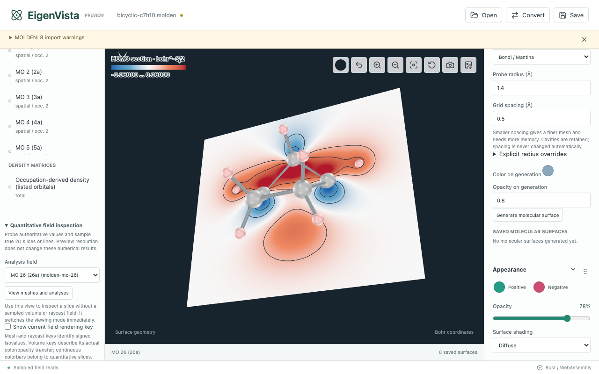
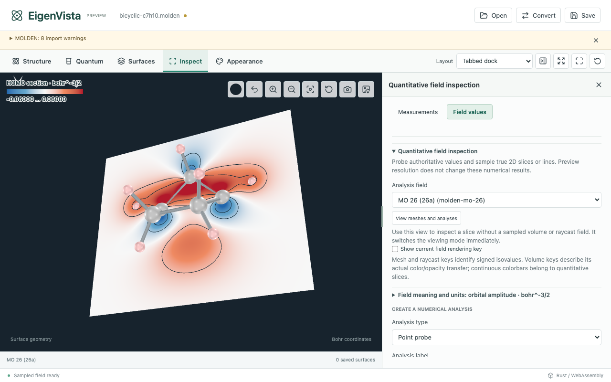
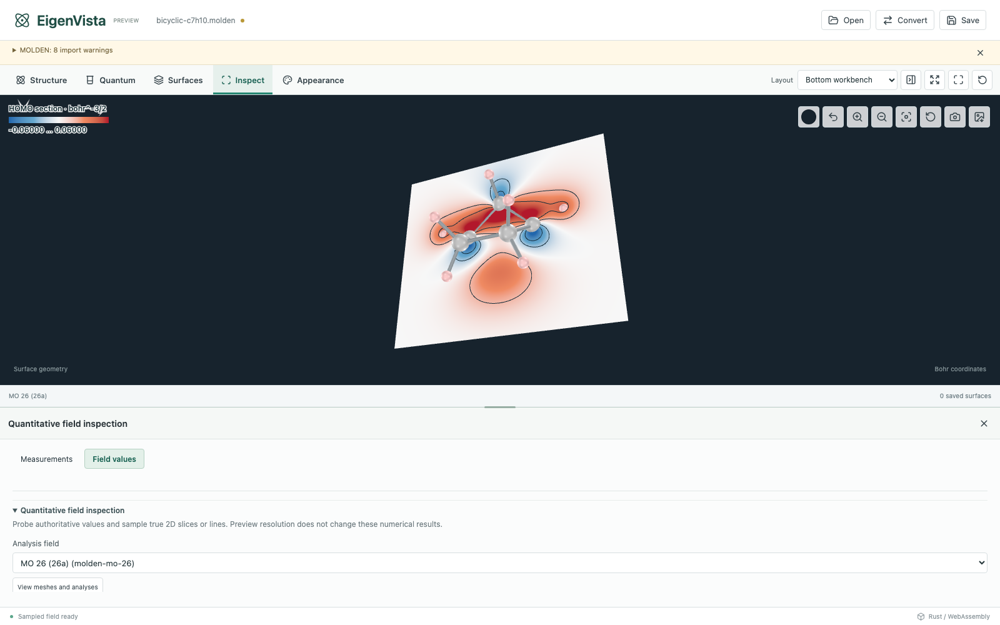
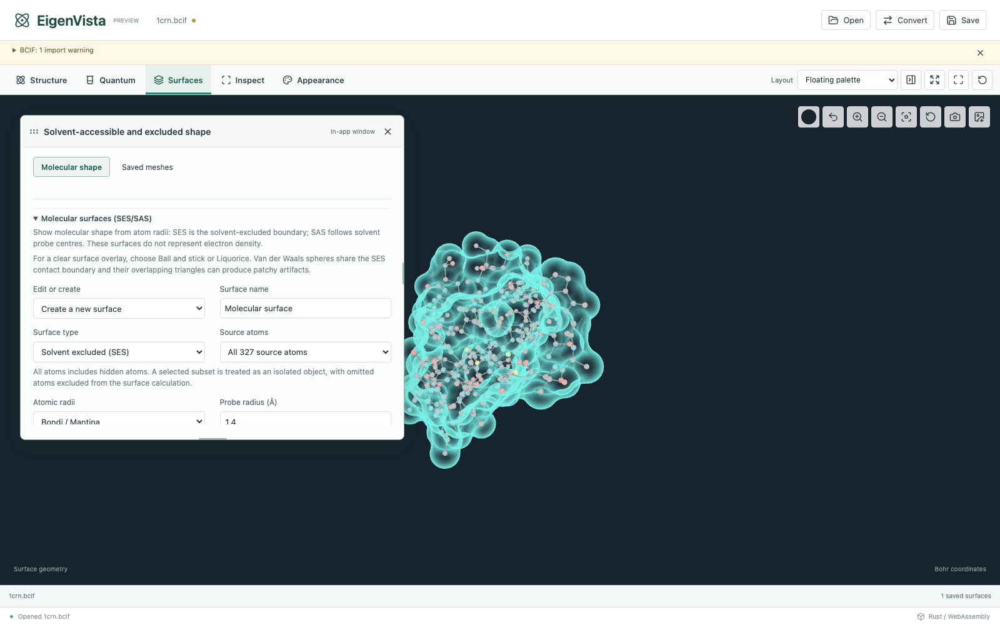
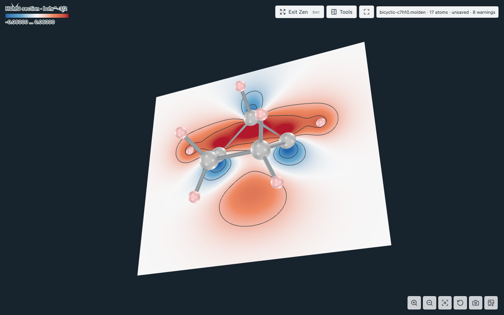

# Desktop workspaces: analysis and interactive experiments

16–17 November 2026 · [#88](https://github.com/uvar-apps/eigenvista/issues/88)

> **Historical experiments — superseded on 17 November 2026.** The user chose
> a simpler left/right pane with four tabs and the original collapsible,
> draggable widgets. Normal startup now opens that replacement (`?workspace=lab`
> remains an alias; `?workspace=legacy` is the historical comparison);
> see [Simple workspace pane](2026-11-17-simple-workspace-pane.md). The five-task
> dock, bottom workbench, floating palette, images and 636-case validation below
> describe the earlier candidate. They are preserved as evidence, not current
> controls, qualification of the replacement or a new application default.

This work follows the user's assessment that the application puts too many
unrelated controls into two fixed, narrow columns. The requested outcome is a
usable scientific desktop workspace, with tools that can be opened and closed,
plus a minimal Zen view and fullscreen. The alternatives below are working
experiments for review. The ordinary startup layout remains available; no new
default or native multiwindow behavior is implied.

## Recommendation

Use **one wide, resizable task dock** as the likely default, with **Structure,
Quantum, Surfaces, Inspect and Appearance** as the five primary tasks. Give
related subtasks their own short row of tabs. Offer a **bottom workbench** for
wide numerical work and an optional **floating tool palette** for adjustments
beside the scene. Every placement must have an obvious close action, a persistent
way to reopen it, and a shortcut. Closing a tool frees its allocated space; it
does not delete results, clear drafts or cancel a calculation.

Keep **Zen** and **fullscreen** independent. Zen removes application chrome
within the current window; fullscreen uses the browser/platform facility. They
can be combined. Both need a reliable return path, the same camera and scientific
objects, and reachable progress/cancellation.

This recommendation is a design inference from the audit, published guidance and
experiments. It is not a claim that any guideline prescribes these exact tabs,
dimensions or colors. The user should compare the working layouts before a
production default is chosen.

## What is wrong with the current arrangement

The problem is structural, rather than a shortage of disclosure triangles:

- Molecular structure, selections, measurements and labels share one long scroll.
  Quantum fields and quantitative analysis share another. Molecular surfaces sit
  below quantum generation controls even when a PDB has no quantum fields.
- Two permanent columns reserve space on both sides of the scene. Collapsing a
  section leaves both columns allocated. Moving sections up and down does not
  increase their working width.
- Coordinate forms, numeric tables and orbital lists have different space needs
  from a color picker. Treating all of them as narrow vertical forms makes the
  numerical work especially difficult.
- General `section` padding is inherited by a nested quantitative creation form,
  compounding the loss of horizontal space.
- The only calculation controls must not disappear when their containing tab or
  tool is closed. Progress and Cancel belong to the workspace as well as the tool.

The following dimensions are **derived from the checkpoint CSS**, before the
experiment. They describe available boxes, not measured text widths:

| Content-window width | Left / right tracks | Scene-column width | Ordinary left / right tool content |
| --- | --- | --- | --- |
| 1024 px | 224 / 246 px | 554 px | 187 / 209 px |
| 1320 px, initial desktop window | 224 / 246 px | 850 px | 187 / 209 px |
| 1920 px | 244 / 266 px | 1410 px | 195 / 217 px |

At 1320 px, the nested numerical form can have only 167 px of content width.
Three coordinates with two five-pixel gaps leave about 52 px per coordinate.
The numerical results table genuinely needs at least 420 px; the existing
horizontal scroll preserves its data, but a wider tool would make rows easier to
read. A profile scaled from a 280-unit SVG into 203 px also shrinks its labels.
Reducing type size would make these problems worse.

The default native content window is 1320 × 860; its configured minimum is
600 × 520. A design must work at laptop sizes and after resizing, not only on a
large monitor. Bottom tools consume scarce height; floating tools consume visible
scene area through overlap. Neither is an unconditional improvement.

## Guidance and precedents

| Source | Relevant guidance or observed capability | Application to EigenVista |
| --- | --- | --- |
| [Apple: Sidebars](https://developer.apple.com/design/human-interface-guidelines/sidebars) | Sidebars primarily support navigation and consume substantial horizontal space. | Separate task tools from document navigation; two permanent navigation columns are not necessary around one scene. |
| [Apple: Split views](https://developer.apple.com/design/human-interface-guidelines/split-views) | Resizable dividers, useful bounds, hideable supplementary panes and multiple reveal routes. | Use a real divider and remove the closed pane's grid track. Restore its size within the current window's bounds. |
| [Apple: Panels](https://developer.apple.com/design/human-interface-guidelines/panels) | Supplemental modeless controls, selection-following inspectors, brief titles; regular Info windows retain their subject. | Appearance adjustments fit a compact inspector; a pinned numerical result must not silently follow a new selection. |
| [Apple: Windows](https://developer.apple.com/design/human-interface-guidelines/windows) | Main and auxiliary windows serve different purposes; automatic proliferation creates clutter. | Start with one coherent workspace. Consider explicit native pop-outs for multi-monitor orbitals/results later. |
| [Apple: Modality](https://developer.apple.com/design/human-interface-guidelines/modality), [GNOME: Dialogs](https://developer.gnome.org/hig/patterns/feedback/dialogs.html) | Interruptions should be justified and focused. | Keep generation, measurement and appearance tools modeless so the molecule remains interactive. |
| [GNOME: Utility panes](https://developer.gnome.org/hig/patterns/containers/utility-panes.html) | Supplementary tools can be toggled; constrained widths can use an overlay. | At narrow widths, dismissible tools overlay the scene instead of squeezing both into unusable columns. |
| [Apple: Tab views](https://developer.apple.com/design/human-interface-guidelines/tab-views) | Group related content under a small number of predictable labels. | Five task tabs with selective subtabs; avoid one primary tab per existing section. |
| [W3C: Tabs](https://www.w3.org/WAI/ARIA/apg/patterns/tabs/) | Linked tabs/panels, one active tab stop, arrow navigation and selected state. | Tab changes are immediate presentation changes; they must not start a calculation or destroy a draft. |
| [W3C: Window splitter](https://www.w3.org/WAI/ARIA/apg/patterns/windowsplitter/), [GNOME: Keyboard](https://developer.gnome.org/hig/guidelines/keyboard.html) | Named, focusable resize controls and keyboard access. APG notes that its splitter pattern is still under review. | Provide pointer and keyboard resizing with announced bounds, plus independent close/reopen controls. These checks alone do not establish accessibility conformance. |
| [W3C: Reflow](https://www.w3.org/WAI/WCAG22/Understanding/reflow.html) | Enlarged text should not lose controls or information; genuinely spatial content has specific exceptions. | Reflow forms and labels; preserve purposeful table scrolling. A 3D canvas does not excuse clipped controls. |
| [ChimeraX: UI commands](https://www.rbvi.ucsf.edu/chimerax/docs/user/commands/ui.html) | Tool show/hide, dockability, fullscreen, expanded graphics and collective hiding of floating panels. | A relevant molecular-viewer precedent for separating scene presentation from scientific data. |
| [Blender: Areas](https://docs.blender.org/manual/en/latest/interface/window_system/areas.html?highlight=new+window) | Maximizing an editor, a more minimal focus mode, restoration and separate editor windows. | Borrow reversible focus modes; a complete area-splitting manager would introduce much more complexity than this application currently needs. |
| [Apple: Fullscreen](https://developer.apple.com/design/human-interface-guidelines/going-full-screen), [MDN: Fullscreen API](https://developer.mozilla.org/en-US/docs/Web/API/Fullscreen_API) | Concentrated visual work still needs essential controls; browser fullscreen requires user activation and actual state/error handling. | Zen is not simulated fullscreen. Observe successful entry, system-driven exit and rejection; retain a visible return route. |

These primary sources were reviewed on 16 November 2026. Apple's linked Markdown
versions supplied the full HIG text. Blender's official indexed content was
available; direct full-page retrieval was not. The separate ChimeraX general
window page was unavailable, so its command reference is the cited evidence.
No third-party product screenshots or UI assets were copied.

## Options compared

The priorities are readable scientific controls, scene space, predictable task
navigation, camera interaction during work, and reliable restoration. The table
uses qualitative tradeoffs rather than unsupported numerical usability scores.

| Arrangement | Practical benefit | Main cost | Decision |
| --- | --- | --- | --- |
| Keep two fixed columns and add tabs | Less scrolling inside each column. | Numeric forms remain narrow; both sides still reserve space. | Insufficient as the main redesign. |
| Two independently resizable/hideable panes | Navigation and inspector can be visible together. | Competes for both edges; users still manage two stacks. | Useful only when a future object navigator has a clear independent role. |
| One wide tabbed dock | Readable forms, one predictable tool location, scene remains interactive; one close action reclaims substantial width. | Switching tasks hides another tool. | Leading default candidate; implemented for comparison. |
| Bottom workbench | Full-width forms and results, good for rows of coordinates, profiles and tables. | Reduces scene height on laptops. | Optional resizable placement; implemented for comparison. |
| Floating modeless tool | Wide controls without shrinking the canvas; easy temporary adjustments. | Overlays the molecule and requires position/focus management. | Optional in-app placement; implemented for comparison. |
| Native detached windows | True multi-monitor work and OS window movement. | Requires explicit shared state, lifecycle, focus and permission design. | Worth a later targeted phase; researched, not implemented here. |
| General IDE/Blender docking manager | Multiple simultaneous task views and arbitrary splits. | Considerable interaction, persistence and maintenance complexity. | Defer until concrete workflows justify it. |

Top tabs make the five tasks discoverable and retain labels. Side tabs can save
some vertical space, but labeled side tabs cost scene width and icon-only rails
make unfamiliar scientific tools harder to discover. Compare that refinement
after validating the task grouping; it is not necessary to introduce two competing
navigation systems in the first experiment.

Modal dialogs remain suitable for short confirmations and file destinations.
The existing **Browse orbitals** dialog remains modal in this experiment. A
persistent modeless orbital table is a worthwhile production follow-up, requiring
explicit draft ownership; changing the dialog's CSS would not implement it.

## Working experiment

Open [the workspace lab](http://127.0.0.1:5178/?workspace=lab) while the local
preview server is running. [Ordinary startup](http://127.0.0.1:5178/) keeps the
comparison layout. Use a separate tab for comparison; a new tab is a new session,
not a copy of another tab's unsaved molecule. Open the same input or a saved
`.eigenvista` document in each session.

The layout selector offers **Tabbed dock**, **Bottom workbench** and **Floating
palette**. These are three placements of the actual application controls, rather
than static mockups. **They are mutually exclusive placements of one tool host.**
One task/subtask is visible at a time; the prototype does not show a dock and a
second independent floating tool simultaneously. The default experiment dock
is 480 px wide; the workbench is 320 px high; the palette starts at 620 × 520 px.
These are starting dimensions,
not minimum requirements. Drag their edges or focus a divider and use arrow keys;
Shift increases the step. Home/End use the current bounds. The floating title bar
supports dragging and arrow-key movement.

| Task | Subtasks and contents |
| --- | --- |
| Structure | Display: representation, biological structure and visibility. Source: provenance and source information. |
| Quantum | Existing field/orbital lists and field rendering/generation together. |
| Surfaces | Molecular shape: SES/SAS definitions and live saved appearance. Saved meshes: quantum/imported meshes. |
| Inspect | Measurements: selections, geometry, labels and neighborhoods. Field values: probes, planes, contours, profiles and numerical results. |
| Appearance | Scene: shading, AO and atom colors. Shaders: custom shader files, targets and parameters. |

**Hide tools** or the tool's close button removes it from the layout. **Show
tools**, a task tab or **Shift+T** brings it back. **Restore workspace** resets
only the experiment layout preferences. The active tool, sizes and placement
are bounded local profile preferences; no molecular document, shader source or
file is stored in them.

**Zen mode** or **Shift+Z** hides the header, task bar, tools and footer. A small
overlay retains Exit Zen, Tools, fullscreen, source identity and an unsaved/warning
indicator; viewport camera/export controls remain available. **Escape** or Exit
Zen restores the previous workspace. Shortcuts leave editable fields and modal
dialogs alone. Fullscreen is a separate action, reports actual browser state and
keeps failures visible. Browser/system fullscreen exit remains authoritative.

Jobs continue when tools close. A global progress strip retains **Cancel
calculation**, including in Zen. Closing or moving a tool must not restart a
calculation or alter previously accepted scientific results.

## Implementation boundaries

The experiment uses one stable viewport owner and one stable tool host. CSS
changes the host's placement rather than remounting it under another React
parent. Each tool stays mounted while hidden, preserving numeric drafts, loaded
shader state and file-picker identity. The existing controller, scientific
workers, validators, result publication and cancellation paths are reused.
Panel headings are simplified only inside the opt-in workspace. Wide containers
reflow selected forms and adjacent sections into columns; the old nested section
padding is reset within the experiment.

At narrow widths, the side dock becomes a dismissible overlay with clamped
dimensions. In windows no taller than 650 px, the bottom workbench also becomes
an overlay so its minimum height cannot consume the entire scene. It remains
resizable and closable. A compact floating palette is limited to three quarters
of the stage width, subject to its readable minimum, so it cannot cover almost
the whole scene. Restored and dragged bounds are constrained to the current
stage so a title bar is not lost outside the window.

The floating palette is **inside the application**, not an OS window or browser
popup. Native detached tools would require a tool-only entry point, one
authoritative main document/controller, bounded snapshot/update transport,
source/window identity, dialog ownership, capability grants, main-close
propagation and off-screen recovery. Opening the normal App in another Tauri
window would create another document and renderer, not detach a tool. Browser
fullscreen checks do not qualify native macOS fullscreen or multi-monitor
behavior. No new connector methods are introduced for these presentation-only
experiments; scientific actions keep using the shared API. Layout, tool
placement and Zen themselves have no connector commands in this prototype.
Decide that presentation-control contract before adopting these as production
features. Simultaneous independent specialist tools are also a later step.

## Measured comparison and actual images

These are actual Chromium measurements at **1280 × 800**, using the same C7H10
source, camera and quantitative plane. Dimensions refer to the drawable scene,
excluding its selection strip. The float is an overlay; its full backing canvas
does not mean every pixel is unobstructed.

| Arrangement | Drawable scene | Tool content width | Interpretation |
| --- | --- | --- | --- |
| Ordinary layout | 810 × 632 px | 203 px field body; 167 px nested form | Narrow controls remain narrow even with a wide monitor. |
| 480 px task dock | 800 × 584 px | 439 px | Fits the 420 px numerical table; about twice the ordinary right-panel width. |
| Bottom workbench | 1280 × 264 px | 1240 px | Useful table width; a substantial loss of scene height on a laptop. |
| Floating palette | 1280 × 584 px | 573 px in this restored profile | Width is useful but overlap is a real cost; move or close it as needed. |
| Tools hidden | 1280 × 584 px | — | Closing the dock recovers 480 px, a 60% increase in scene width. |
| Zen | 1280 × 800 px | — | Full content-window scene, with minimal controls and the scientific legend. |

The dock does **not** claim more scene area while open: the additional task bar
costs 48 px in height, and its wider tool uses 10 px more total width than the old
two columns at this window size. Its benefit is readable tasks, fewer unrelated
controls and immediate recovery of the allocated space. The default was increased
from 440 to 480 px after measuring that 399 px of content still did not fit the
real results table. Preferences may retain a smaller, clamped size after a narrow
window; the measured float is 615 px wide rather than its initial 620 px.

At the configured 600 × 520 minimum, the first floating candidate left only
7.63% of the scene unobstructed. The compact-width correction leaves **28.82%**
and closes to recover the whole scene, passing the unchanged 20% visibility
floor. Short bottom workbenches use the overlay fallback described above.

Ordinary layout, showing the original competing columns:

Wide task dock, preserving the source and camera:

Bottom workbench on a larger window; its height tradeoff remains visible:

Modeless in-app palette, real 1CRN SES, Pastel atoms and the X-ray shader:

Zen keeps the scientific key clear and moves the small controls to the trailing
edge; compact windows put them below the key:

Images retain their original aspect ratios. [Capture provenance and metadata](assets/desktop-workspaces-2026-11-17/README.md)
identify inputs, camera, geometry, source hashes and original files. The local
stage also retains all 20 final comparison PNGs and the earlier candidates.

## Validation and adoption

The final focused workspace matrix passes **22/22 cases in Chromium and WebKit**
(37.5 seconds, one worker). It exercises actual controls and science workers,
canvas/file-input/tool-host identity, drafts, camera/revision/dirty preservation,
controller image output, task/subtask keyboard navigation, pointer/keyboard
resizing, independent scroll positions, focus recovery, real fullscreen entry/
exit, actual partial-progress cancellation and recovery, and a held real Save
without a misleading Cancel action in the new global strip. Window checks include 1600, 1280, 820 and
390 px widths plus 600 × 520 and 1024 × 600. Real C7H10 plane/phase pixels are
read from the compositor before export; actual transparent legend pixels are
checked for nonoverlap with Zen controls. Real 1CRN SES appearance is exercised.

TypeScript, changed-source formatting and the production frontend build pass.
The complete application regression suite passes **636/636 browser cases**
(318 per engine, 22.8 minutes, one worker; zero failures, skips, flaky results or
retries) on local macOS 27.0/arm64. All 125 recorded runtime/test/dependency hashes
match before and after the run. This includes the 22 new workspace cases above.
Exact evidence is recorded in the [living handoff](../handoff.md). The older
614-case checkpoint result remains historical. No native bundle or Rust rebuild
is implied by these frontend checks. Site source/output, scientific/native code,
dependencies and generated WASM are unchanged.

Visual review corrected shared scrolling that hid subtabs, invisible focus after
hide/Zen, excessive floating overlap at the minimum size, and a Zen toolbar over
the scientific legend. An immediate WebKit screenshot initially showed a blank,
stretched resize frame; settled actual draws and independent compositor pixels
confirmed correct rendering without a renderer change. These earlier failures
are retained as candidate evidence, not counted as passes.

Both tested engines successfully used actual browser fullscreen. Unsupported
browsers have explicit error handling in source; that branch was not reached in
this run. Native macOS fullscreen, physical system
Escape, assistive-technology use and multi-monitor windows remain unqualified.
The app leaves Escape to the platform while fullscreen is active, so a subsequent
Escape can leave Zen after fullscreen ends; explicit exits remain available.
The implemented splitter keys are arrows, Shift+arrows and Home/End. Enter
collapse/restore from the evolving APG pattern is not claimed; Close/Show tools
provides that keyboard-accessible operation separately.

Production adoption should follow the user's review of the three placements.
The recommended first production direction is the **wide task dock**, with Zen
and easy hide/reopen. Treat bottom results and temporary appearance palettes as
optional secondary tools, rather than relocating every task there by default.
The bottom prototype exposes width/height tradeoffs; a production workbench should
arrange definitions and results beside one another, not simply stretch all
controls across the bottom. A modeless orbital/results tool, a compact inventory
of selected scientific objects and persistent job/error reporting are more useful
next refinements than a fully general docking framework. Native pop-outs and
simultaneous independent tools should be scoped and qualified separately.
No commit, tag, push, PR, merge, release or new default is part of this experiment.
