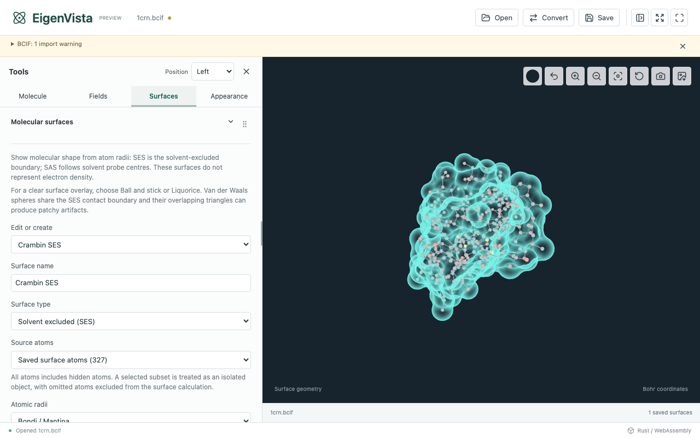
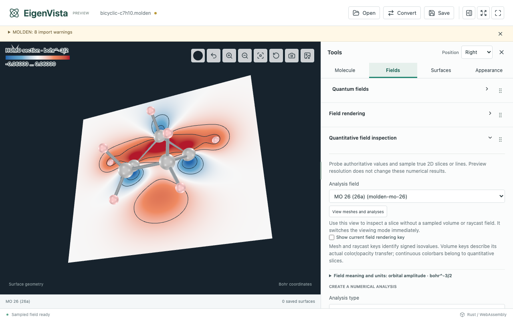
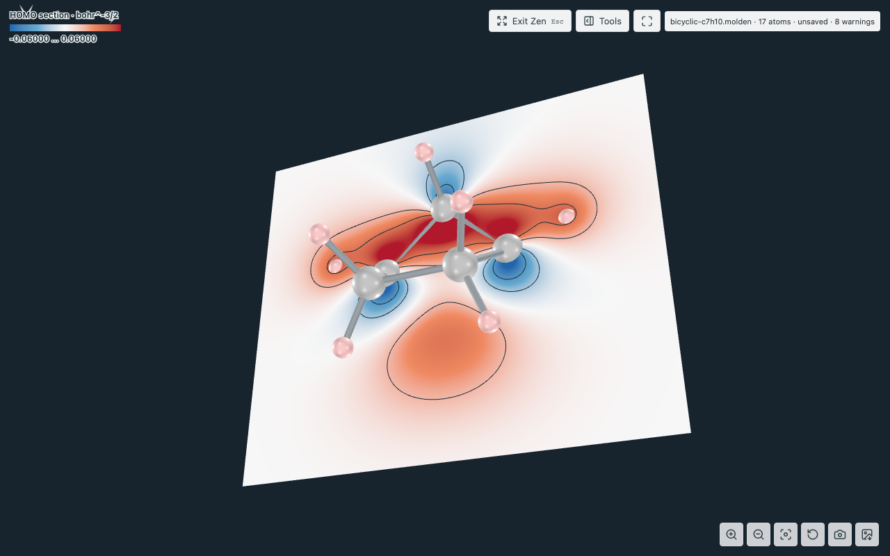

# Simple workspace pane: user-selected direction

17 November 2026 · [#88](https://github.com/uvar-apps/eigenvista/issues/88)

The user reviewed the first workspace experiments and chose a simpler,
IDE-style arrangement: one wider pane, selectable on the left or right, with
no more than four tabs. Keep the familiar toolbar, status area and collapsible,
draggable widgets. This supersedes the earlier five-task dock, bottom workbench
and floating-palette alternatives in the opt-in workspace lab.

The user has approved this as the normal startup. Default-promotion validation
is pending below; published 0.8.0 downloads are unchanged.
The [earlier research and experiments](2026-11-16-desktop-workspaces.md) retain
their original measurements, images and validation as historical evidence.

## The chosen arrangement

One tool pane starts at **480 px wide**, on the **right**. Its Position control
moves it to the left. Drag its inner divider to resize it; closing it gives the
allocated width back to the molecular view. There is no second pane, bottom
workbench, floating palette or nested task-tab system.

Four tabs sit **inside the pane**, beneath its short Tools heading:

| Tab            | Collapsible widgets                                             |
| -------------- | --------------------------------------------------------------- |
| **Molecule**   | Molecular data; Selections and measurements; Provenance.        |
| **Fields**     | Quantum fields; Field rendering; Quantitative field inspection. |
| **Surfaces**   | Molecular surfaces; Saved surfaces.                             |
| **Appearance** | Appearance; Atom colours; Surface shader.                       |

These groups reuse the application's existing scientific controls. They do not
introduce a new way to define an orbital, a surface, a measurement or a shader.
The additional selection, field-inspection and molecular-surface groups get the
same collapsible widget wrapper as the familiar sections.

Each tab has one scrollable stack. Widgets can be collapsed and reordered within
that tab by their grip handles. The grip also offers Move up/Move down buttons
and keyboard movement. Moving widgets between tabs is outside this design;
keeping four predictable task groups is deliberate.

The existing application header, Open/Convert/Save actions, file information,
status/footer and viewport controls remain in their familiar places. Three
compact actions in the existing header provide Show/Hide tools, Zen and
fullscreen. There is no additional full-width workspace command bar.

## Trying the pane

With the local preview running, open [normal startup](http://127.0.0.1:5178/).
The old lab flag is no longer needed. Separate browser tabs have separate
application sessions; an unsaved molecule is not copied between them.

1. Choose **Molecule**, **Fields**, **Surfaces** or **Appearance** in the pane.
2. Use **Position** to choose the left or right edge.
3. Drag the divider to adjust width. A focused divider supports Left/Right arrows,
   Shift+arrows for a larger step, and Home/End for its current bounds.
4. Collapse widgets by their headings. Drag a widget's grip within its tab, or
   focus the grip and use Up/Down, Home/End, or its move buttons.
5. Close the pane with its **Close tools** button or the header's **Hide tools**
   action. Reopen it with **Show tools** or **Shift+T**.

Tab buttons also support Left/Right arrows and Home/End. These keys change the
visible task; they do not submit a form or begin a calculation.

At narrow window widths the same pane becomes an edge overlay, avoiding a
permanently squeezed scene. It can be closed to expose the full view. Pane width
is clamped to the available window; the initial 480 px is a starting preference,
not a promise that every smaller window can display it beside a useful scene.

## Zen, fullscreen and ongoing work

**Zen mode**, also available with **Shift+Z**, hides the application header,
footer and tool pane. A small overlay retains Exit Zen, Tools, fullscreen,
source identity and unsaved/warning information. Viewport camera/export controls
remain available. Choosing Tools leaves Zen and opens the pane.

**Fullscreen** is independent: it requests the browser's actual fullscreen
facility and observes its state. A visible error reports unavailable or rejected
entry. Fullscreen does not silently choose a tab, reset the camera or discard
scientific results.

Escape leaves Zen when browser fullscreen is not active. While fullscreen is
active the platform gets Escape first; use its fullscreen exit, then Escape to
leave Zen, or use the explicit visible controls. Workspace shortcuts leave text
editing and visible modal dialogs alone. The existing **Browse orbitals** chooser
remains modal; it is not a new independent orbital window.

Closing the pane or changing tabs is a presentation action. Running work stays
with the existing calculation owner. A global activity strip remains outside the
pane, including in Zen, with Cancel calculation when that operation supports
cancellation. A noncancellable operation must not acquire a misleading Cancel
button merely because its tool is hidden.

## State and implementation boundaries

The molecular viewport and tool widgets keep their owners while the pane moves,
closes or changes tabs. Hidden widget bodies remain mounted, preserving local
drafts and file-input identity during these transitions. Widget reordering uses
stable keys rather than recreating the scientific tools.

Presentation preferences remember the pane side, width, active tab, visibility
and per-tab widget order. Existing widget disclosure preferences retain their
ownership; the three newly wrapped widgets have bounded presentation settings.
These preferences contain no molecular arrays, shader source, file grants or
calculation state. Zen is transient. Preserving drafts while switching tools does
not mean that unsaved drafts or molecular sessions survive an application reload.

The pane is implemented by `WorkspacePane.tsx`, `useWorkspacePane.ts` and
`workspace-pane.css`, with the reusable widget stack in `PanelSidebar.tsx` and
`PanelSection.tsx`. Normal startup selects this presentation. The explicit
legacy route preserves the previous sidebar contracts for compatibility tests,
not a second concurrently mounted controller.

Scientific actions continue through the existing shared controller and workers.
This adds no connector commands for pane position, tabs, widget order
or Zen. Such presentation control requires an explicit production API decision;
it must not be advertised as implemented AI control of the workspace.

Only one pane and one tab's stack are visible at a time. Simultaneously visible
specialist tools, modeless orbital/results windows and native detached windows
remain future possibilities. Native macOS
fullscreen, window activation, multi-monitor placement and assistive-technology
qualification are separate from browser layout checks.

## Actual comparison images

At 1280 × 800 with the same C7H10 source, camera and quantitative plane, the
drawable scene is **800 × 632 px** with the 480 px pane on either side. Hiding
the pane gives **1280 × 632 px**; Zen gives **1280 × 800 px**. The original
ordinary layout's scene was 810 × 632 px: the simpler pane preserves its scene
height while giving widgets approximately twice their former working width.

Left pane with real 1CRN SES, Pastel atoms, X-ray shader and draggable widget:

Right pane with real HOMO plane, collapsed widgets and quantitative inspection:

Zen with the same scientific scene and unobstructed legend:

Images preserve their original aspect ratios. [Capture provenance](assets/simple-workspace-pane-2026-11-17/README.md)
records inputs, camera, geometry, original dimensions and source/image hashes.
All 20 final desktop/laptop/compact comparison images remain in local staging.

## Validation and review status

Source inspection confirms the arrangement. The following results belong to the
opt-in candidate before promotion; fresh default-startup results are recorded below.
All **24 focused workspace cases** pass in Chromium/WebKit, including actual
scientific controls, widget collapse/drag/keyboard/menu ordering, preserved
source/camera/drafts/file nodes, pane side/resize/hide, original chrome, real
fullscreen, cancellation and compositor/legend checks. All **38 existing
disclosure/order cases** pass. Twenty final comparison images have been captured
and reviewed. TypeScript, formatting and production frontend build pass.
The complete suite passes **638/638 application browser cases** on local macOS
27.0/arm64: 319 per engine, 26.1 minutes, one worker, zero failures/skips/flaky
results/retries. All 124 recorded runtime/test/dependency hashes match before and
after the run. The [living handoff](../handoff.md) identifies the exact evidence.
No native package or fresh Rust/native qualification is implied by these frontend
checks; scientific/native/dependency source and generated WASM are unchanged.

The tests found a real WebKit scroll-retention gap when hiding a tab. Each tab's
scroll position is recorded while visible and explicitly restored on return,
pane reopening and side changes. Both engines pass the regression. Earlier
test-sequence mistakes (an open move menu and asynchronous wheel timing) and the
failing WebKit candidate remain preserved separately from accepted evidence.

The earlier **636-case** browser run, five-task screenshots and dock/bench/float
measurements qualify the superseded candidate only. They do not validate this
replacement. The new images and measured geometry above belong to this actual
simple-pane candidate; no old image is relabeled as the new design.

The user approved adoption, including readable forms, useful scene space,
left/right placement, retained widget behavior and Zen. The pane is now normal
startup in 0.10.0. Fresh default-startup qualification passes **646/646** cases
(323 per engine, 24.3 minutes, one worker, zero failures/skips/flaky cases/retries)
with all 234 frozen source hashes unchanged. Coverage includes actual Molden
orbital/plane workflows, 1CRN SES, hidden-pane cancellation, retained camera,
accepted results and drafts. The complete fresh Rust/build/native/packaging and
162-case website evidence is recorded in the living handoff. Actual Tauri UI
checks include plane creation, both pane sides, resizing, hide/reopen, Zen and
WebKit fullscreen. The historical 638-case run remains separate. Commit/tag/push
and PR/merge follow the user's delivery instruction; a new binary package is
separate.
