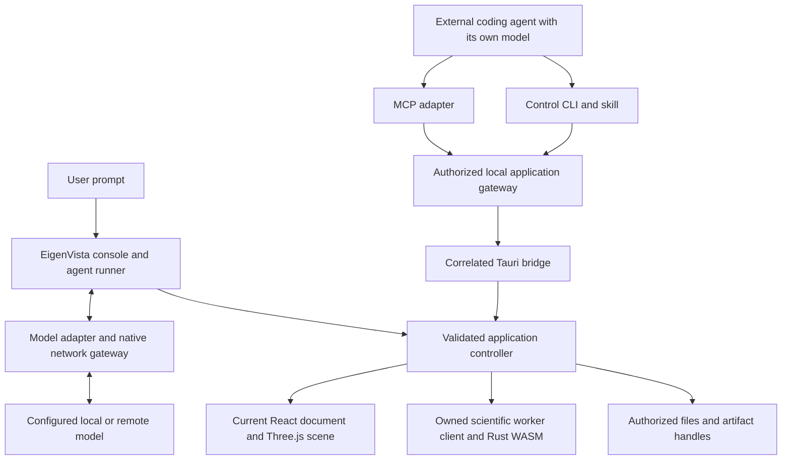

# AI console and external-agent API: research and recommendations

**Date:** 15 November 2026, Australia/Perth.  
**Status:** research and proposed architecture; no implementation authorized by this document.  
**Code reviewed:** EigenVista 0.7.2, main `d48a8111c5908559ac7842ac95052201e95b7cf7`.

**Follow-up, 16 November 2026:** the user selected the shared application API and
external connector first, with no embedded console, scripting runtime or visible
GUI changes. [Issue #78](https://github.com/uvar-apps/eigenvista/issues/78) and the
[accepted implementation decision](../design/2026-11-16-application-control-api.md)
track that scope. The remainder of this report preserves the original research.
The local implementation is documented in the [API guide](../application-control.md)
and [verification handoff](../handoff.md#shared-application-control-api-16-november-2026).

This report investigates both requested products:

1. **An EigenVista-hosted AI console:** a user enters a prompt in the application;
   EigenVista runs the agent loop against a configurable local or remote model.
2. **An application API for external coding agents:** an existing agent controls
   EigenVista through tools, a CLI/skill, MCP, or another adapter. That agent
   supplies its own model and authentication; EigenVista need not call any model.

“Self-hosted console” here means that EigenVista owns the conversation and tool
execution, without a required vendor-hosted agent service. The inference server
can still be local or remote. An embedded console and an optional separately
served console could share the same application API.

## Recommendation

Build **one versioned application command API**, then place both AI experiences
above it. The main work is exposing reliable application operations, rather than
choosing a fashionable wire protocol.

- For the embedded console, use a small agent runner with separate **Chat
  Completions and Responses adapters**, a configurable endpoint/key/model, and
  application-side validation of every requested action.
- For external agents, prioritize **MCP plus a live-app control CLI and a skill**.
  This covers MCP-aware hosts and agents that can invoke local commands. External
  control must work with the embedded console disabled and no model key stored
  in EigenVista.
- Use **JSON-RPC 2.0 over a private local connection** as a reasonable first
  attachment mechanism for the native application. Start with an MCP stdio
  adapter that attaches to the selected running application. Authenticated
  loopback HTTP is a viable alternative if browser/HTTP clients are an early
  requirement; choose one initially.
- Consider **UTCP** as a later discovery description over those existing tools.
  Add REST/OpenAPI or WebSockets when a concrete integration requires them.
- Defer GraphQL, embedded Python, AG-UI, ACP and A2A until their particular
  benefits are needed. The commonly named **UCP and AP2 concern commerce and
  payments**, so they do not fit molecular-viewer control.

These are recommendations, not claims about features already present.

## 1. What the application actually exposes today

My previous autonomous use was through **real UI automation**: setting controls,
clicking commands, moving the camera and exporting images. It was not an existing
public EigenVista agent API. See the [capture helper](../../tools/site/capture-quantum.mjs),
particularly its control, camera and image-export procedures.

| Existing boundary | Evidence in the reviewed source | Implication |
| --- | --- | --- |
| React owns the current document and presentation | [App.tsx](../../app/src/App.tsx), document/live refs at lines 175–187; [architecture](../architecture.md#boundaries-and-ownership) | The agent must operate on the document the user actually sees. A second disconnected document in a server is insufficient. |
| Scientific work runs in Rust/WASM through a Web Worker, including in the desktop app | [science.worker.ts](../../app/src/science.worker.ts), [science.ts](../../app/src/science.ts) | The worker protocol provides computation, not complete viewer control. |
| Computation has owned cancellation and a shared FIFO | `science.ts:56`, `:118`, `:138` | Agent cancellation must preserve other owners' queued work and current worker-registration rules. |
| Import, preview and mesh generation already have important transition rules | `App.tsx:220`, `:295`, `:493`, `:515` | Wrap these flows and retain their validation, atomic publication and stale-result checks. |
| Save uses a current snapshot and native validation | `App.tsx:586`; [native entry](../../app/src-tauri/src/main.rs) | A tool must distinguish successful save, user cancellation, busy state and error. |
| Camera, background and PNG export are inside the viewport | [Viewport.tsx](../../app/src/Viewport.tsx), background at line 176, capture at line 811 | A deliberate viewport control/capture port is needed; calling the scientific worker cannot manipulate these. |
| Native IPC is currently limited | `app/src-tauri/src/main.rs:123` registers version, saves and native-exit commands | A native REST/MCP server alone would not control React/Three.js without an explicit frontend bridge. |
| The existing CLI converts and checks documents | [eigenvista-convert](../../crates/eigenvista-convert/src/main.rs), help at line 12 | It does not attach to a viewer, set a camera, generate viewer surfaces or capture its scene. |
| File access is user-selected | [files.ts](../../app/src/files.ts), [native capabilities](../../app/src-tauri/capabilities/default.json) | Unattended path-based import/export is a new capability requiring a defined file-access contract. |
| Packaged renderer networking is narrow | [tauri.conf.json](../../app/src-tauri/tauri.conf.json), CSP at line 23 | Configurable inference URLs are not currently enabled as arbitrary renderer connections. |

Several handlers return `void`, return early when busy, or communicate failure
only through UI state. For example, calling `generateOrbitals` is not evidence
that its calculation completed. A controller needs explicit results instead of
an API that merely invokes those handlers and immediately reports success.

The existing [scientific contracts](../architecture.md#scientific-contract),
[registration ownership](../design/2026-11-06-worker-ownership-and-registration.md)
and [persistence boundaries](../architecture.md#persistence-versus-transient-state)
remain authoritative.

## 2. Separate the layers

There are four different interfaces to design:

| Layer | Purpose | Examples |
| --- | --- | --- |
| Application semantics | What an operation means and when it succeeds | Select a field, sample it, generate surfaces, set the camera, capture PNG |
| Process/transport | How a caller reaches a running application | In-process call, Tauri IPC, local socket/pipe, HTTP, stdio, WebSocket |
| Agent tool discovery | How an agent learns and invokes capabilities | MCP tools/resources, CLI help and skill, UTCP manual, OpenAPI |
| Model inference | How an agent asks an LLM for text and proposed tool calls | OpenAI-shaped Chat Completions or Responses endpoints |

An OpenAI-compatible endpoint supplies model inference. It does not itself
connect to EigenVista, execute application tools, or become an MCP client.
The agent host performs that work. OpenAI's documented function-calling flow
requires the application to execute requested functions and return their results.
[Function-calling guide](https://developers.openai.com/api/docs/guides/function-calling.md).

The gateway and bridge are proposed components. Tauri already provides
commands, events and channels, but its IPC is an internal native/frontend
boundary, not an external automation service. Use correlated requests/results
and appropriate streaming channels; do not expose arbitrary JavaScript evaluation.
[Tauri IPC](https://v2.tauri.app/concept/inter-process-communication/),
[calling the frontend and channels](https://v2.tauri.app/develop/calling-frontend/).

## 3. The shared application API

### Initial operation catalog

The following names are illustrative, **not existing commands**. Each operation
should have a schema, bounded result, capability requirements and error codes.

| Family | Useful initial operations | Result/boundary |
| --- | --- | --- |
| Discovery | Capabilities, application/window identity, current state | API version, document identity, revisions, available operations and busy state |
| Molecular data | List orbitals/fields, chains/components, saved surfaces | Paginated metadata and stable IDs; no coefficient matrices or meshes by default |
| Documents | Open an authorized file; save to an authorized destination | Import report, dirty-state outcome, validated save receipt |
| Field display | Select field; select mesh/raycast/volume; set resolution/isovalue | Explicit mode/field changes, or a sampling job receipt |
| Surfaces | Generate selected orbitals/density surfaces; visibility; removal | Job receipt or document mutation result; current limits remain enforced |
| Molecular presentation | Representation, chain colors/subsets, palette, AO | Validated current presentation settings |
| Surface shaders | Select bundled preset; change declared uniforms; clear | Validated preset/parameters and actual compile/render outcome |
| Camera | Fit, zoom, orbit, get/set camera pose, focus selection | Camera/scene revision and applied pose |
| Capture | PNG with normal or transparent background | Artifact handle, dimensions, MIME type and scene revision |
| Jobs | Status, progress, bounded wait, cancel | Accepted/running/terminal state and operation ownership |

Start with inspection, existing presentation controls, bundled shaders and
capture. Full document editing, arbitrary GLSL supplied by a model, shell access
and general code execution do not belong in the initial tool catalog.
Capabilities must reflect the loaded document and its declared field semantics.
Missing quantum fields or unknown scalar meaning should produce explicit
unavailable/unknown results rather than invented data or interpretations.

### State and mutation semantics

1. **One controller owns accepted state.** UI controls and agent adapters enter
   the same operations. Extract incrementally; do not rewrite all of App merely
   to add a protocol.
2. **Identify the instance and document.** Include application/window ID,
   document ID and a monotonic revision. External clients must select the intended
   running instance rather than silently controlling whichever one is found first.
3. **Separate document and scene revisions.** Camera movement should not make a
   scientific result stale by itself. Require only the revisions relevant to an
   operation, and recheck scientific/publication assumptions before committing.
4. **Preserve validation and immutability.** Schema validation cannot replace Rust
   import, numerical, allocation or native-publication validation. Do not mutate
   nested scientific arrays behind the registration/cache mechanism.
5. **Distinguish outcomes.** Return structured `busy`, `unsupported`,
   `stale_document`, `invalid_arguments`, `permission_required`, `cancelled` and
   operation-failure results. Do not translate a silently ignored handler into
   success.
6. **Make retries safe.** Give mutations idempotency/request IDs, retain a bounded
   receipt history and let clients query uncertain outcomes before retrying.
7. **Describe persistence truthfully.** Native Save persists scientific data,
   meshes and selected view settings. It does not currently preserve the complete
   camera/AO/shader/background/biological-display session. A future replay recipe
   should be separate from claims about today's native format.

### Jobs, cancellation and rendering

Expensive operations should return an accepted receipt with a job ID, then
publish real progress and a terminal outcome. A calculation is complete only
after its result passes validation and reaches accepted application state.
Capture should additionally wait for the requested scene revision to be drawn;
use a renderer completion signal, not arbitrary sleeps or stale success text.
PNG capture must reuse the existing synchronous draw/read path, including AO
and transparent-background restoration.

The embedded runner can wait locally for its job without repeatedly asking the
model to poll. External clients can use status/bounded-wait/cancel operations.
Progress should be throttled for UI/event delivery rather than consuming model
context one update at a time.

Associate jobs with their initiating run/client. Stopping an assistant should
abort its inference request and offer an explicit policy for its owned
calculations, without cancelling unrelated user/converter work. A disconnected
transport and an explicit job cancellation are different events. Accepted
detached jobs need a documented lifetime; initially that can be the current app
instance, with an explicit expired/restarted result after shutdown.

Keep large arrays in the application. Tool results should contain counts,
energies, occupations, warnings, selected settings, progress and artifact handles.
Images/native files should use an artifact/file channel, not enormous JSON or
base64 strings in every conversation. Handles need ownership, size limits,
expiry and a defined retrieval mechanism.

## 4. Option A: EigenVista-hosted AI console

### User experience and runtime

An embedded console can show the prompt, assistant text, requested operations,
actual progress, errors and generated image previews. Provide Stop and direct
access to the existing application controls. Record executed operations and
outcomes; the interface does not need to expose hidden model reasoning.

The runner's basic cycle is:

1. Read a bounded application summary and the relevant tool definitions.
2. Send the conversation to the configured model.
3. Assemble a complete proposed tool call and validate it against the controller.
4. Execute or await that operation; show actual progress.
5. Return a bounded result to the model, then continue or finish.

Limit turns, elapsed time, output size and repeated failures. Serialize document
mutations even when a model proposes parallel calls. Read-only queries can be
concurrent when the controller permits them. The model's output is a request,
not permission to bypass application policy.

### Configuration: URL and key are nearly enough

Use a small normal connection screen:

| Setting | Proposed behavior |
| --- | --- |
| Base URL | API prefix, such as `http://localhost:11434/v1`; validate and normalize once |
| API key | Optional for local servers that require no authentication; Bearer token when configured |
| Model | Discover through `/models` when available, with manual model-ID entry |
| API dialect | Automatic/profile choice with explicit Chat Completions and Responses overrides |

A model ID is still needed even if discovery hides the typing. Do not silently
select the first listed model: it may be unsuitable or expensive. Listing models
is not a test of tool calling. Put context/output limits, timeouts and compatibility
overrides in advanced settings.

### What “OpenAI-compatible” does and does not establish

| Officially documented behavior | Design consequence |
| --- | --- |
| OpenAI's current guide requires Responses for tool calling with some current models, including GPT-6 Astra and GPT-6.1 Sol. | Chat Completions alone cannot meet the broad compatibility goal. [OpenAI function calling](https://developers.openai.com/api/docs/guides/function-calling.md) |
| Ollama documents a subset of the API, `/v1/models`, local examples with an ignored SDK key, and stateless Responses without `previous_response_id`/`conversation`. | Support optional local authentication and maintain conversation state in EigenVista. [Ollama compatibility](https://docs.ollama.com/api/openai-compatibility) |
| LM Studio distinguishes native model tool support from generic prompt/parser support. Its server can run without authentication or require tokens. | Model/template capability and server authentication are separate connection properties. [Tool use](https://lmstudio.ai/docs/developer/openai-compat/tools), [authentication](https://lmstudio.ai/docs/developer/core/authentication) |
| llama.cpp documents native/generic tool templates and server setup such as `--jinja`. | A reachable server does not establish reliable tool use for every loaded model. [Function calling](https://github.com/ggml-org/llama.cpp/blob/master/docs/function-calling.md) |
| vLLM tool behavior depends on server flags, parser and template; parsers differ in strict/parallel/forced-tool support. | Unsupported request parameters need a clear capability/profile policy. [Tool calling](https://docs.vllm.ai/en/stable/features/tool_calling/) |

Normalize both inference dialects into internal text deltas, complete tool calls,
usage, errors and completion events. Collect streamed argument fragments by call
ID/index. Never execute incomplete JSON after a truncated stream. Strict schema
mode is useful where supported, but validation remains in the application.
[OpenAI tool-call streaming and schemas](https://developers.openai.com/api/docs/guides/function-calling.md).

Qualify endpoint **and model** combinations with a harmless inspection tool and
round trip. Report tool-capable, chat-only, unsupported dialect, authentication
failure or connection failure distinctly. A later structured-JSON proposal mode
could help weaker models, but should be separate from qualified native tool use.
No implementation can guarantee reliable control from every model merely because
its server accepts OpenAI-shaped HTTP requests.

Text-only models should be sufficient for normal operation because state is
structured. Screenshot feedback is optional and requires both a vision-capable
model and a supported image-input path. It should not be mandatory for listing
orbitals, selecting fields or changing a representation.

### Native and browser networking

For the desktop, a useful split is a shared TypeScript runner/controller plus a
**narrow Rust model gateway** for outbound HTTP and stored credentials. That fits
the current UI/science separation and avoids opening the packaged renderer's CSP
to arbitrary model hosts. The gateway should accept a configured connection ID
and supported inference requests, rather than become a model-controlled general
HTTP proxy.

Keep stored keys in native credential storage; exclude them from conversation
history, application documents, diagnostics and the external control API. User
entry may pass briefly through the settings UI, but subsequent requests should
refer to the connection profile instead of repeatedly exposing its key.

The browser preview needs a different transport implementation: direct browser
requests require the inference server to allow that origin through CORS, or an
explicit companion backend must make the request. Treat this as a separate
qualified deployment mode. A localhost endpoint can itself forward to cloud
inference, so show the selected endpoint/model and data-sharing mode.

### Existing libraries worth evaluating

Avoid implementing provider stream parsers and protocol SDKs from scratch when
maintained libraries fit. The **AI SDK OpenAI-compatible provider** is a credible
TypeScript spike candidate: its documented configuration includes a base URL,
optional key and custom fetch. A native-backed fetch transport and any Responses
provider path still need testing; its existence is not proof of Tauri or all-model
compatibility. [Provider documentation](https://ai-sdk.dev/providers/openai-compatible-providers).

Alternatively use a small explicit runner over qualified provider clients. Keep
an internal provider interface so a library can change without changing the
application command schema. A large workflow framework or Python sidecar is not
necessary for the first bounded tool loop. No SDK/dependency choice was made or
installed during this research.

### Separately self-hosted consoles: reuse instead of building the chat UI

This is another valid form of Option A. Run an existing console locally or on a
chosen server, configure its model endpoint, and connect it to EigenVista's tools.
The console owns the agent loop and model key; the application still owns its
command controller and file/action grants.

| Candidate | Documented integration | Consequence for EigenVista |
| --- | --- | --- |
| **Open WebUI** | Configurable OpenAI-compatible model providers; core native MCP support uses Streamable HTTP. Its documented MCPO bridge exposes stdio/older SSE MCP through OpenAPI tools. | Reuses chat/provider/history UI, but requires a reachable HTTP tool endpoint or bridge. A native stdio helper alone is insufficient for core Open WebUI. [Provider connections](https://docs.openwebui.com/getting-started/quick-start/connect-a-provider/starting-with-openai-compatible/), [MCP support](https://docs.openwebui.com/features/extensibility/mcp/) |
| **LibreChat** | Custom model endpoints; MCP configuration includes process and network transports; Agents can use OpenAPI Actions. Some current MCP pages are labelled Latest/dev. | Can use a locally launched MCP adapter when its backend is on the same machine, or a qualified network connection. Pin a deployed release and verify the chosen model/Agents/MCP combination. [Custom endpoints](https://www.librechat.ai/docs/quick_start/custom_endpoints), [MCP configuration](https://www.librechat.ai/docs/configuration/librechat_yaml/object_structure/mcp_servers), [Agents](https://www.librechat.ai/docs/features/agents) |

These products reduce chat UI work but do not remove the need for an EigenVista
API or a connection to the actual viewer. A child process runs on the console
backend's machine. In a container, `localhost` names the container, not the user's
desktop; a hosted console also cannot reach a private desktop socket by magic.
Address the topology explicitly without publishing an unrestricted viewer port.
Open WebUI documents this host/container distinction in its provider setup.

For a native desktop product, the small embedded console remains my preferred
integrated experience: it can share current state, jobs, previews and cancellation
directly. Separately self-hosted consoles are useful optional API clients,
especially for people who already operate one. Embedding an entire console in
an iframe is not necessary to support this option.

## 5. Option B: external coding agents

### CLI plus skill

A new control CLI should **attach to the running viewer**, identify its instance,
authenticate and invoke the same controller. A proposed name is
`eigenvista-ctl`; this is distinct from today's converter. Useful properties are
JSON output, stable exit codes, discovery/help, bounded job waits and artifact
retrieval. Do not duplicate scientific evaluation in this CLI.

A coding-agent skill can teach the agent to discover capabilities, inspect state,
use returned IDs, preserve units, await jobs and inspect captures. It is
documentation and workflow guidance, not a transport or authorization boundary.
Different coding agents have different skill formats and installation rules;
ship common API instructions plus small host-specific installation notes.

This gives a practical fallback for agents without MCP support but with an
authorized shell/process tool. “Any coding agent” means an available integration
path for its capabilities, not a promise that every host supports one universal
plugin format.

### MCP adapter

Expose focused named tools from the same command catalog, bounded resources and
artifact references. An agent launched outside EigenVista owns the model loop
and its credentials. It does not need EigenVista's optional provider settings.
[MCP tools](https://modelcontextprotocol.io/specification/2026-07-28/server/tools),
[resources](https://modelcontextprotocol.io/specification/2026-07-28/server/resources).

For native use, a **stdio MCP adapter** can be launched by the agent host and
attach to the chosen running EigenVista instance through private local IPC.
Starting a stdio process must not silently create a disconnected second viewer.
Send protocol messages on stdout and diagnostics on stderr.

An MCP endpoint hosted in the app through Streamable HTTP is an alternative for
clients that connect to an independently running service. It still needs the
frontend-controller bridge. It also introduces listener, authentication, Origin
and lifecycle responsibilities. [MCP transports](https://modelcontextprotocol.io/specification/2026-07-28/basic/transports),
[stdio](https://modelcontextprotocol.io/specification/2026-07-28/basic/transports/stdio).

**Version caution:** the official versioning page currently identifies
**2026-07-28** as Current. Its per-request metadata/discovery model and HTTP
binding differ from the older 2025 handshake/session examples. Select and pin an
SDK/protocol combination that actually works with the target coding agents;
do not mix examples from different revisions. Supporting older clients may
require explicit compatibility behavior.
[Versioning](https://modelcontextprotocol.io/docs/2026-07-28/learn/versioning).

In the current Streamable HTTP binding, messages use POST with JSON or
request-scoped SSE responses; the older standalone GET/session mechanism is
absent. Closing an in-flight response stream cancels that MCP request. This is
different from disconnecting after a start-job request has already returned a
detached application job ID: that job's lifetime and explicit cancellation are
defined by EigenVista. [Current HTTP binding](https://modelcontextprotocol.io/specification/2026-07-28/basic/transports/streamable-http).

Keep start/status/cancel job tools available independently of **MCP Tasks**.
Tasks is an opt-in extension with client-support and durability requirements;
an in-memory viewer job ID is not automatically a durable MCP task.
[Tasks extension](https://modelcontextprotocol.io/extensions/tasks/overview).

### Live application attachment

The native gateway should correlate requests to the active frontend controller,
return an explicit unavailable result if the window is gone, and reject stale
instance/document handles. A private per-user Unix socket on macOS/Linux, with
a corresponding Windows local-IPC adapter later, avoids a default TCP listener.
Use a qualified portable IPC library rather than spread platform branches through
the scientific code. Test framing, message limits, backpressure and shutdown.

If authenticated loopback HTTP is chosen instead, use explicit enablement,
instance selection and a separate application-control credential. Validate
Origins/Host as applicable and avoid permissive CORS. MCP's HTTP binding itself
calls for Origin validation and appropriate local-server protections.
[Streamable HTTP security](https://modelcontextprotocol.io/specification/2026-07-28/basic/transports/streamable-http).

A pure browser tab cannot host the native process/socket service. External
control of that deployment needs an explicit companion broker/authorized tab
connection, or a browser automation integration. Desktop-first is a reasonable
initial scope; do not imply that a native MCP server also provides headless
Three.js/GPU rendering automatically.

## 6. API and transport comparison

| Option | Practical value | Cost or limitation | Recommendation |
| --- | --- | --- | --- |
| Typed in-process API | Lowest overhead for UI and embedded console; direct promises/events | Not reachable by another process | Shared foundation |
| Tauri IPC/channels | Existing native/frontend boundary and streaming primitives | Not an external-agent API; needs correlation and controller integration | Native bridge and model gateway |
| JSON-RPC 2.0 | Small transport-independent request/result/error vocabulary | Does not supply authentication, jobs, framing or application semantics; notifications do not acknowledge success | Good local wire envelope. [Specification](https://www.jsonrpc.org/specification) |
| REST + OpenAPI | Broad curl/Python/web compatibility; natural binary artifact endpoints and generated clients | Additional listener/API surface; progress/jobs need design; OpenAPI describes HTTP, not a separate transport | Add for actual HTTP consumers. [OpenAPI](https://spec.openapis.org/oas/v3.2.1.html) |
| HTTP + SSE | Simple one-way progress/text stream with separate commands | Need authentication, sequencing and reconnect policy; native EventSource is not a generic custom-header client | Prefer for one-way streams if using HTTP. [SSE standard](https://html.spec.whatwg.org/multipage/server-sent-events.html) |
| WebSockets | Bidirectional continuous scene events and steering | Need message schemas, backpressure, reconnection and ordering; not automatically a tool protocol | Later if continuous interaction needs it. [Standard](https://websockets.spec.whatwg.org/) |
| GraphQL | Selective reads over rich metadata | Adds resolvers/schema/subscription machinery; subscriptions do not guarantee delivery or select a transport | Defer for the initial command-oriented API. [Specification](https://spec.graphql.org/September2026/#sec-Subscription) |
| Declarative command recipes | Reproducible workflows without executing arbitrary code | Need versioned parameters, file references and stop/failure semantics | Useful after commands stabilize |
| Embedded JS/Python | Powerful user scripting and ecosystem access | Larger execution/packaging surface; Python adds interpreter integration | Later bindings to the same API. [Python embedding](https://docs.python.org/3/extending/embedding.html) |
| Browser/UI automation | Works against actual controls today; useful independent visual verification | Fragile labels, timing, dialogs and large screenshot context | Retain for tests/fallback, not the primary agent contract |

Implementing REST, GraphQL, WebSockets and MCP simultaneously would multiply
adapters without improving the underlying operation semantics. A common schema
can generate compatible tool/CLI descriptions, but provider-specific projections
still need tests rather than assuming all JSON Schema subsets are identical.

## 7. Other named agent protocols

| Option | What it standardizes | Fit for this project |
| --- | --- | --- |
| **UTCP — Universal Tool Calling Protocol** | Manuals/call templates describe how to call existing native HTTP, CLI and other tools. Docs advertise 1.1; the 1.0.0 RFC is marked Draft. | Optional discovery adapter after the CLI/API exists. It does not create the missing app operations or replace their authorization. [Introduction](https://www.utcp.io/docs/), [RFC/status](https://www.utcp.io/about/RFC) |
| **ACP — Agent Client Protocol** | Client/editor sessions with a complete coding agent; official docs list v1 Latest and v2 Draft. | Relevant if EigenVista later embeds an external coding-agent process in its console. That agent still needs EigenVista tools. Different from directly calling a configurable model endpoint. [Introduction](https://agentclientprotocol.com/get-started/introduction) |
| **AG-UI** | Agent-runtime to UI event sequences for messages, calls, state and progress | Possible console/backend contract if adopting a compatible runtime; does not define molecule/scene operations. [Specification](https://docs.ag-ui.com/spec/1.0) |
| **A2A** | Task delegation between independent agent systems | Useful later for a goal-oriented “EigenVista visualization agent,” rather than just exposing application actions. [Specification](https://a2a-protocol.org/latest/specification/) |
| **UCP — Universal Commerce Protocol** | Interoperation between commerce platforms, agents and businesses, including checkout | No current fit for molecular visualization. [Official overview](https://ucp.dev/) |
| **AP2 — Agent Payments Protocol** | Agent-authorized commerce/payment mandates and receipts | No current fit; it is not a general app-control API. [Specification](https://ap2-protocol.org/ap2/specification/) |

UCP is an overloaded acronym. The assessment above concerns the official
Universal Commerce Protocol commonly discussed alongside AP2. A different UCP
project would need its exact specification assessed separately.

## 8. Permissions, scientific fidelity and reproducibility

These are application design requirements shared by both paths:

- **Grant useful scopes once per authorized connection/run.** Read-only
  inspection and permitted presentation changes should not trigger repetitive
  approval prompts. Preserve existing unsaved-document, save and overwrite rules.
- **Separate credentials.** Model-provider authentication and application-control
  authentication have different purposes. Never give an external agent the model
  key merely because it can call a viewer tool.
- **Define file grants.** Browser file objects and native paths are different.
  Use user-selected files/roots and explicit artifact destinations; do not give
  model arguments unrestricted filesystem authority.
- **Treat file metadata and tool text as data.** Molecular titles, imported
  comments, shader text and other returned content must not redefine the tool
  policy or cause automatic execution of instructions embedded in a file.
- **Preserve resource bounds.** Expose currently available resolutions and
  allocation/batch limits through capabilities. Prompts cannot increase them or
  alter authoritative scientific values behind validation.
- **Keep units explicit.** EigenVista's molecular data model uses bohr internally; displayed coordinates
  may be angstrom and orbital energies hartree. Commands/results need units and
  stable IDs, rather than interpretations based only on labels or row numbers.
- **Minimize inference payloads.** Summaries first; full inputs/screenshots only
  when needed and permitted. Local inference and a local proxy to cloud inference
  are different data-sharing choices.
- **Record actions, not just conversation.** A reproducible recipe needs input
  hashes, selected IDs, numerical parameters, shader/palette identifiers, camera
  and transient display settings. Record requested versus applied values and
  artifact hashes. Chat history alone is not scientific provenance.

The text console should not be a general shell disguised as a molecule tool.
General scripting can be a separately scoped future facility.

## 9. Suggested implementation order

| Increment | Deliverable | Acceptance boundary |
| --- | --- | --- |
| 1. Shared controller | Queries, explicit state/revisions, viewport port, structured errors, jobs, file/artifact contract | Direct API actions match existing UI behavior and preserve scientific/save/cancellation contracts |
| 2A. External-agent path | Local attachment, control CLI, a skill, MCP tools/resources | An external coding agent controls an already running authorized viewer without an EigenVista model key |
| 2B. Embedded console path | Prompt UI, bounded runner, model configuration, two inference dialects, native network/secret gateway | A qualified local model and hosted endpoint perform the same workflows with responsive UI and cancellation |
| 3. Broader adapters | UTCP manual and, if needed, REST/OpenAPI or web companion connection | Same command semantics and scope checks, without duplicated application logic |
| 4. Advanced workflows | Recipes, optional scripting, AG-UI/ACP/A2A integrations | Implement only when a concrete workflow justifies their extra runtime/protocol surface |

2A and 2B are independent after the foundation. I would default to **external
control first** because it immediately reuses the user's existing coding agents
and model setup, while validating the command API before adding an inference
client and chat UI. If the embedded console is the main product priority, reverse
those two increments without changing the foundation.

Before implementation, open/reuse tracking issues under the repository's
[issue taxonomy](../labels.md) and agree the first tool subset. This research
does not authorize implementation, dependency installation, a listener, model
calls, issue publication, commits or deployment.

## 10. Qualification work before claiming support

Use real application operations and real endpoint/model combinations. Useful
initial scenarios are:

1. Open an authorized Molden document, list orbitals, select one and show a
   volume preview without first generating meshes.
2. Generate selected surfaces, observe real progress, cancel an owned operation
   and verify unrelated work/previous geometry survive.
3. Change representation, colors/AO, shader parameters and camera; capture normal
   and transparent PNGs through the existing final-frame path.
4. Inspect and act through the console and external MCP/CLI against the same
   document; change the document manually while a delayed tool call is pending.
5. Save current state through existing validation; exercise dirty replacement,
   cancelled dialogs, stale snapshots and protected source paths.
6. Test model discovery/manual selection, authenticated/unauthenticated local
   connections, both dialects, fragmented calls, unsupported parameters,
   malformed arguments, timeouts and finite loop budgets.
7. Disconnect/reconnect an external client, restart the app, repeat a mutation
   request and verify instance selection, expired handles and idempotency.
8. Verify no provider key or large scientific arrays enter tool results/logs,
   and imported text cannot expand the action/file grants.
9. Qualify MCP against selected real client/SDK revisions, including older-client
   behavior; keep jobs usable without the Tasks extension.

Current project policy requires all relevant checks locally before pushing,
including macOS browser/native acceptance where affected. Linux qualification
joins when the promised local machines are available; this report supplies no
new platform qualification. See [AGENTS](../../AGENTS.md#required-local-validation-before-pushing)
and [development](../development.md#verification-commands).

## Evidence limits and decisions still open

This was a source inspection and official-documentation investigation. No model
endpoint, SDK, external agent or new protocol implementation was exercised; no
application code, dependencies, runtime configuration or running process changed.
Protocol/provider documentation was checked on the report date and can change.
The tables assess fit, not measured interoperability or implementation cost.

Before coding, settle the first command subset, desktop-versus-browser delivery
scope, target external agents/MCP revisions, local-IPC versus loopback-HTTP
attachment, file/data-sharing scopes and the initial qualified model matrix.
The recommended API/controller split lets those choices evolve without
reimplementing EigenVista's scientific or presentation behavior.
