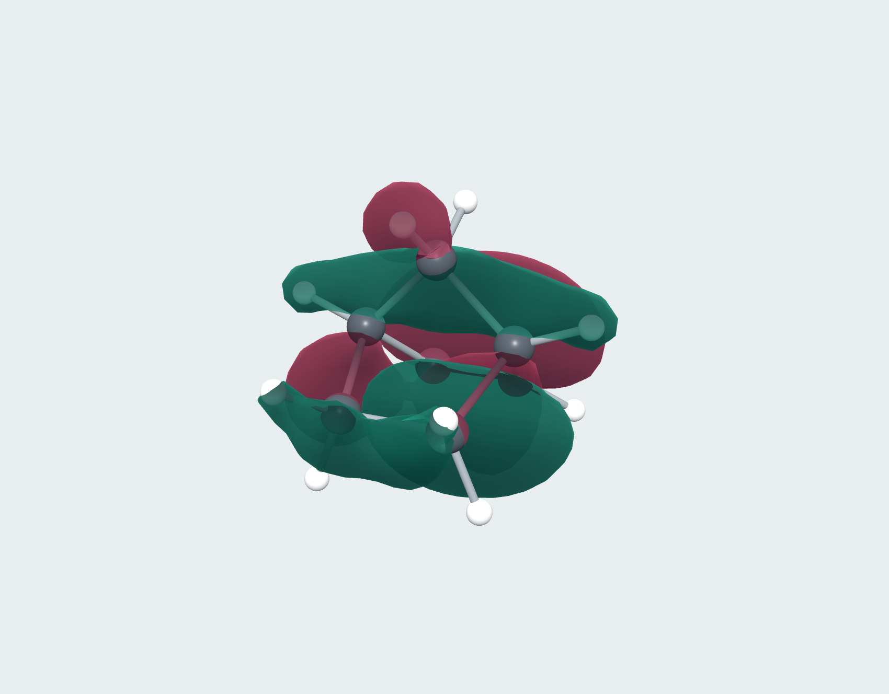
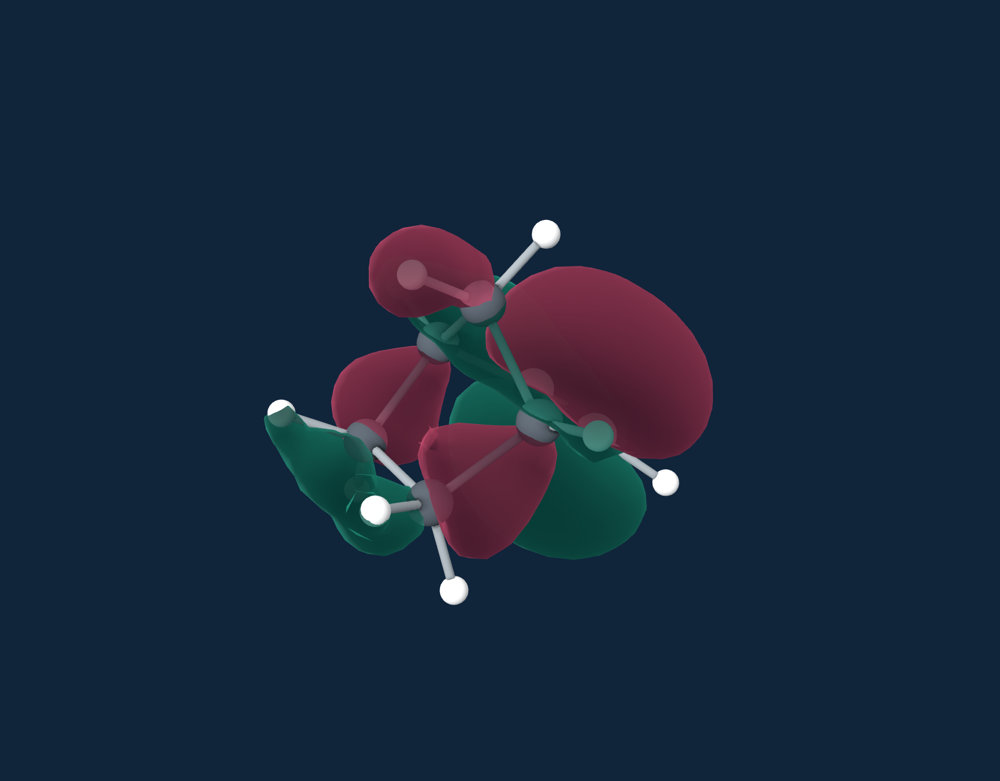
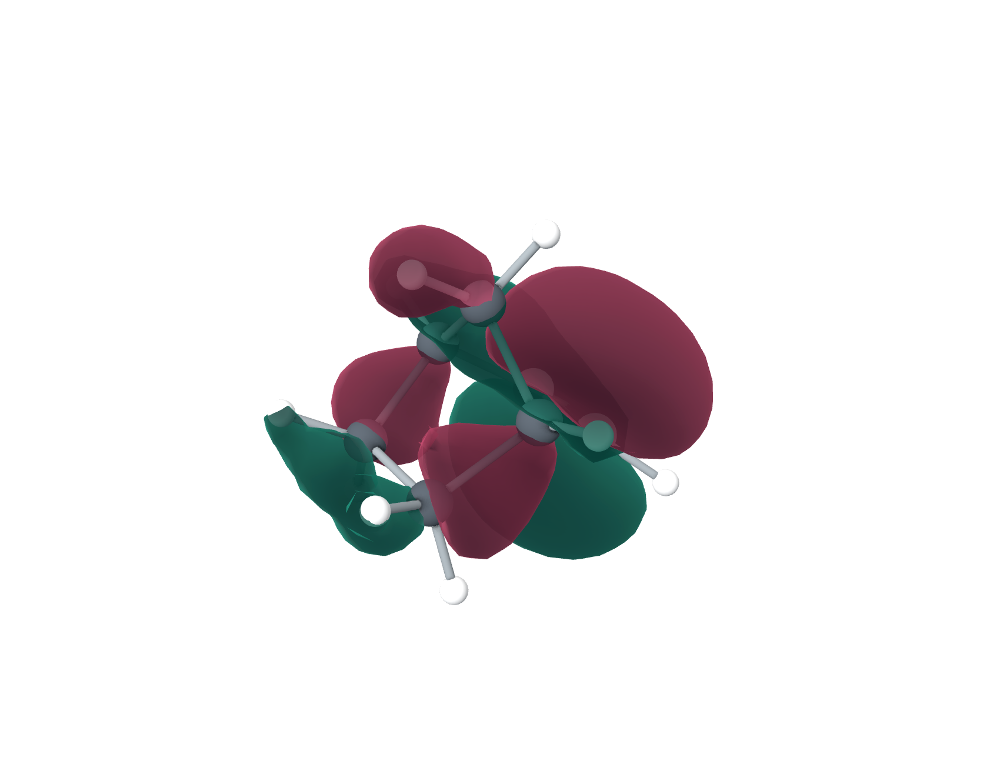
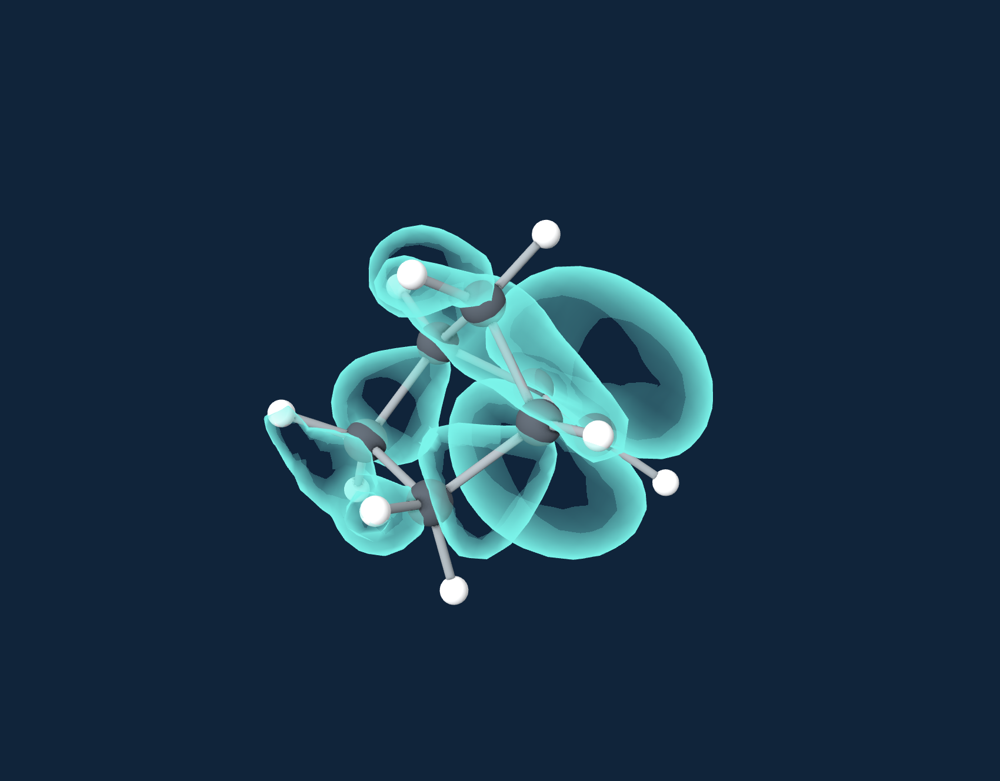
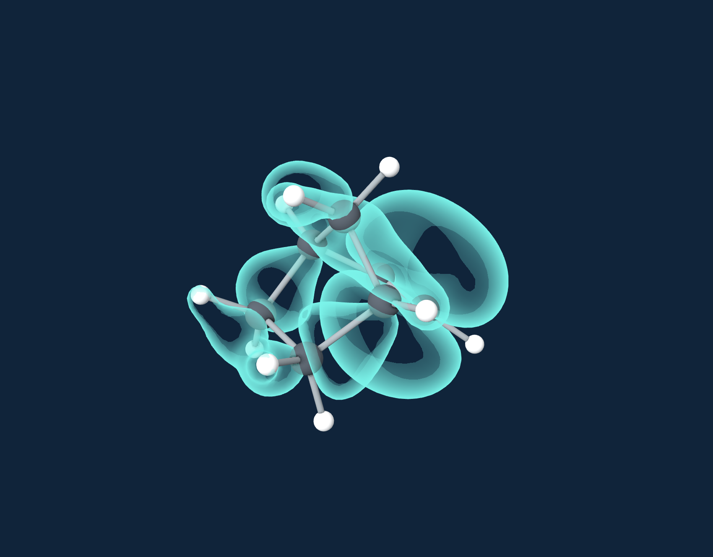

# Start EigenVista with external control

Source: https://chatgpt.com/s/cx_6afa6aac0fa48191befd5ad211e86009

Exported: 16 November 2026. Seven exchanges and six attached images.

## Exchange 1

### User

Work in /Users/ugo/projects/eigenvista. Start EigenVista with external control enabled. Allow reading tools/site/examples/ and saving results under tmp/prompt-demo/. Leave the application running.

### Assistant

EigenVista is running with external control enabled and verified.

- Input: tools/site/examples/
- Output: tmp/prompt-demo/
- Connection: connection.json

The application is left running.

## Exchange 2

### User

Open bicyclic-c7h10.molden from the examples directory. Tell me its atom count and identify its HOMO and LUMO, including their energies and occupations.

### Assistant

Opened bicyclic-c7h10.molden in EigenVista. It contains **17 atoms**.

From the file’s orbital energies and occupations:

| Orbital | Identity | Energy (hartree) | Occupation |
| --- | --- | --- | --- |
| HOMO | MO 26 (26a) | −0.20945781051103 | 2 |
| LUMO | MO 27 (27a) | −0.022452121682877 | 0 |

The file remains open and the application is running.

## Exchange 3

### User

Render the HOMO as positive and negative isosurfaces at an isovalue of 0.03 and grid resolution 64. Fit the molecule in the view.

### Assistant

Rendered HOMO **MO 26** at **±0.03** using a **64 × 64 × 64** grid. Positive is teal; negative is pink. The view is fitted, and EigenVista remains running.

## Exchange 4

### User

Set a dark blue background, enable ambient occlusion for the molecule, and rotate the view 30 degrees horizontally and 15 degrees vertically.

### Assistant

Applied dark blue (#10243a), enabled molecular ambient occlusion, and rotated the view **30° horizontally / 15° vertically**. EigenVista remains running.

## Exchange 5

### User

Save this view as tmp/prompt-demo/homo.png, also export a transparent-background version, and show me the images here.

### Assistant

Saved both images at **1700 × 1328**. EigenVista remains running.

**Dark blue background — homo.png**

**Transparent background — homo-transparent.png**

## Exchange 6

### User

Now I want to apply a shader that renders the surfaces as X-Ray making the center almost completely transparent with a tick contour

### Assistant

Applied the X-Ray shader to both surfaces, with transparent centers and thick cyan contours. EigenVista remains running.

## Exchange 7

### User

perfect, now increase the resolution of the meshes to make them look round

### Assistant

Increased the grid from **64³ to 128³**, producing smoother contours with **18,736 triangles**. The X-Ray shader and viewing angle are preserved.

