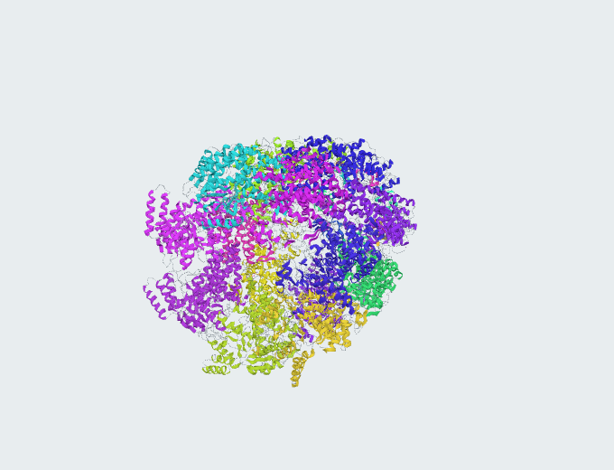
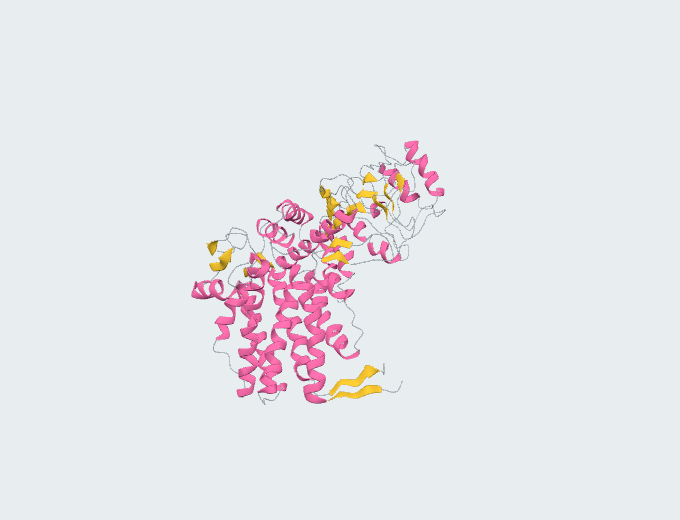

# EigenVista user guide

## What this program does

EigenVista displays molecular structures and quantum-chemistry fields in an
interactive 3D scene. You can open Molden wavefunctions,
PDB/mmCIF/BinaryCIF/XYZ structures, and
Gaussian cube scalar fields, inspect automatically computed bonds, display
supplied orbitals or density matrices, generate signed
isosurfaces, and save the molecular data and surface geometry together in a
portable `.eigenvista` document.

This guide describes version 0.8.0, an experimental
development preview. Scientific calculations and rendering have targeted tests,
but the application is not yet a qualified scientific release. It visualizes
supplied data; it does not calculate a wavefunction from atom positions.

Version 0.8.0 adds optional AI-enabled viewing through your external coding
agent. The Mac app bundles its connection helper, launcher, examples and
palettes; no source checkout or compiler is required. Start with the
[connector guide](ai-connector.md) and [0.8.0 release notes](releases/0.8.0.md).
See [current status](status.md#source-version-080) for release qualification.

Version 0.7.2 added scene background controls and transparent PNG export
([#73](https://github.com/uvar-apps/eigenvista/issues/73),
[#74](https://github.com/uvar-apps/eigenvista/issues/74)), plus optional MatterViz
Muted/Pastel atom palettes. Read the [0.7.2 notes](releases/0.7.2.md) and
[status](status.md#source-version-072) for fresh release checks and delivery.
Fresh 0.7.2 checks passed locally on macOS, including all 526 browser cases.
The [0.7.2 release page](https://github.com/uvar-apps/eigenvista/releases/tag/v0.7.2)
provides the verified rebuilt Apple Silicon ZIP, checksum and build metadata,
including `Palettes/`. The prior feature verification is recorded separately.
The published
[0.7.1 release](https://github.com/uvar-apps/eigenvista/releases/tag/v0.7.1)
retains its original verified package, which predates these additions.

Version 0.7.1 renamed **Document** to **Molecular data**. Version 0.7.0 added
[biological structure views](#biological-structure-views), retaining molecular
ambient occlusion and sidebar reordering. Earlier packages remain historical;
updating source does not update an installed app or existing archive.

EigenVista is the new name of the Molekel Rust preview. Its icon and logo are
unchanged. New documents use `.eigenvista`; existing `.molekel` preview files
remain supported, including their scientific data and saved surfaces.

## Install and start on a Mac

The tester ZIP is for **Apple Silicon Macs** (M-series processors), not Intel
Macs. It targets macOS 13 or later; that complete OS range has not been tested.
The package's `BUILD-INFO.json` records the actual build system. Linux and
Windows packages are not available yet.

1. Unzip the package and move `EigenVista.app` to Applications.
2. Double-click the app. A mathematical hydrogen-pair example opens initially.
3. Keep the rest of the extracted package for this guide, examples, build
   information, license notices, and source code.

You do not need Rust, Node.js, a development server, or an internet connection
for the installed app's local molecular-file workflows.

The tester app is ad-hoc signed, not Developer ID-signed or Apple-notarized.
If macOS blocks it because the developer cannot be verified, only proceed if
you trust its origin and integrity. After trying to open it, use **System
Settings > Privacy & Security > Open Anyway**, then confirm Open for this app.
Do not disable Gatekeeper globally. Stop and report malware or damaged-app
warnings instead of bypassing them. Managed Macs may disallow exceptions.
See [Apple's security instructions](https://support.apple.com/en-us/102445).

## A first session

1. Click **Open** and select `Examples/water.pdb` from the extracted ZIP.
2. The Molecular data panel should show **3 atoms** and **2 bonds**. Bonds are computed
   automatically, including when the file has no explicit connections.
3. Try the **Representation** choices: Ball and stick, Liquorice, and Van der
   Waals. The last uses space-filling spheres and does not draw bond cylinders.
4. Drag in the scene to rotate it; scroll or use **Zoom in** / **Zoom out** in
   the viewport toolbar to zoom. Use **Fit scene** to restore the framing.
5. Click **Save**, choose a new `.eigenvista` filename, and reopen it with **Open**.
   Your structure, connectivity, and representation are retained.

`Examples/water.xyz` provides the same three-atom/two-bond check. Preserve your
original inputs: the preview does not retain every source-format annotation.
Use the app's Open button; Finder file associations and drag-and-drop loading
are not implemented.

## Finding your way around

| Area | Purpose |
| --- | --- |
| Top bar | Document title, unsaved-change indicator, Open, Convert files, and Save |
| Molecular data panel | Atom/bond/basis counts, representation, example menu |
| Quantum fields | Select an active field; the Orbitals (count) button lists all orbitals for multi-selection |
| Provenance | Source descriptions, import decisions, and loss notices |
| Central scene | Molecule and surfaces; selected atom/surface information below |
| Field rendering | Rendering mode, isovalue, grid resolution, Generate/Cancel |
| Appearance | Positive/negative colors and opacity |
| Saved surfaces | Current document's meshes, visibility, triangle counts, deletion |
| Footer | Busy state, completion information, or errors |

On a narrow browser window these areas rearrange; scrolling may be needed.
Toolbar icons show their names on hover.
Click a sidebar section's heading to collapse or expand its controls. Keyboard
users can focus the heading with Tab and activate it with Enter or Space.
Collapsing a section retains its current settings and selections. The eight
sections start expanded; your choices are remembered in this browser or desktop
profile across Open, Clear and restart. They are interface preferences, separate
from the saved molecular document. If profile storage is unavailable, the
choices last for the current session.

**Field rendering** stays expanded while a calculation is running, so its
progress report and **Cancel** button remain available. Its previous expansion
choice returns when the calculation finishes or is cancelled.

To reorder sections, drag a heading's **Reorder** handle onto the upper or lower
half of another section to place it before or after that section in the same
sidebar. The left and right sidebars keep their own sections.
You can also click or tap the handle for **Move up** and **Move down**, or focus
it with Tab and press Up/Down; Home/End moves to the start/end of that sidebar.
The handle keeps keyboard focus and announces the new position. Escape closes
the move controls and returns focus to the handle. In Safari on macOS, use
Option-Tab to reach buttons if ordinary Tab skips them, or enable Keyboard
Navigation ([Safari shortcuts](https://support.apple.com/guide/safari/keyboard-shortcuts-and-gestures-cpsh003/mac)).
Your order is
remembered with this profile across Open, Clear and restart, independently of
section expansion and saved molecular files. Reordering also works during a
calculation; progress and Cancel remain available.

The runtime badge reads **Native (Tauri)** in the desktop shell and
**WebAssembly** in the browser. It identifies the runtime, not verified support
for additional operating systems.

## Moving and inspecting the scene

- Left-drag rotates. Right-drag pans; Ctrl-drag is another pan gesture.
- Scroll or hold the middle mouse button and drag vertically to zoom.
  The **Zoom in** and **Zoom out** toolbar buttons work without a wheel;
  keyboard users can Tab to either button and activate it with Enter or Space.
  On a touchscreen, one finger rotates and two fingers pinch/pan.
- Click an atom to see its element/index and coordinates in angstroms. Click
  a mesh to see its label and triangle count. There is no measurement tool yet.
- **Fit scene** and **Reset view** currently do the same thing: fit all displayed
  objects and restore the default viewing direction.
- **Background color** opens a color picker in the scene toolbar.
  The initial color is `#e8edef`; **Reset background color** restores it.
  The color is a session display setting and is not saved in molecular files.
- The camera icon, **Export image**, requests a PNG download of the current
  viewport named `eigenvista-view.png`, with the selected opaque background.
- The additional image/download icon, **Export image with transparent
  background**, downloads `eigenvista-view-transparent.png`.
  Empty scene areas are transparent; antialiased edges and translucent surfaces
  retain their alpha. The selected background remains visible in the application.

Both export actions capture the current camera view, including after idle
periods, zooming or resizing. They export the rendered scene without toolbar or
text overlays. A failed export reports an error without replacing the document;
you can retry an encoding failure. The actions use the browser/WebView download
mechanism; download handling varies by host. Browser export is the reference
path, and native image-download handling still needs qualification.

The scene uses bohr internally. Picked atom positions are converted to angstroms.
The display table covers all accepted elements (Z 1–118) with a **distinct
colour per element**, taken from the Jmol CPK palette (Z 1–109) and OpenBabel's
continuation of it (Z 110–118). Radii are van der Waals radii from Alvarez
(2013), with Rahm–Hoffmann–Ashcroft (2016) supplying Pm and Po–Ra. Fm–Og have
no published van der Waals radius; they use the Pyykkö single-bond covalent
radius scaled by 1.65, the mean unbound/cov1 ratio over Ac–Cm, which keeps the
periodic trend instead of flattening it. A Rust test re-derives every radius
from the same `pdbtbx` tables, so the table cannot drift from its sources.
Bond inference uses a separate, complete covalent-radius table; display-radius
choices do not affect it.

## Supported files

| Extension | What is read | Important boundary |
| --- | --- | --- |
| `.eigenvista`, legacy `.molekel` | Current or previous Rust-preview scientific document, appearance, and saved meshes | Missing display bonds are filled in on Open; not a general legacy C++ Molekel project reader |
| `.molden`, `.molf`, `.molden.input` or recognized Molden header | Geometry, Gaussian basis, real orbitals, energies, occupations, and occupation-derived density matrices | Canonical S/P/D/F/G and SP; explicitly identified ORCA exports currently S/P/spherical D only |
| `.xyz` | One conventional atom-count/comment/coordinate frame, in angstroms | Geometry and automatically inferred bonds; multiple frames and extended XYZ are rejected |
| `.pdb` | Selected ATOM/HETATM geometry and explicit plus inferred bonds | First model/structure and one alternate conformer per residue |
| `.cif`, `.mcif`, `.pdbx` (mmCIF) | Selected `_atom_site` geometry, declared pair connections, and coordinate-based gap filling | First model/alternate selection; declared covalent/disulfide/metal links are untyped display connections, with source details in provenance; no symmetry-mate expansion |
| `.bcif`, `.bcif.gz` (BinaryCIF) | The same selected geometry, declared connections, and provenance policy as text mmCIF | Bounded BinaryCIF 0.3.x, one data block; raw and gzip-wrapped content are detected independently of filename; no quantum data or symmetry expansion |
| `.cube`, `.cub` | One scalar field, bohr geometry, and computed bonds; includes single-orbital cubes | Multi-field and alternative-unit cube profiles are not supported |

PDB selection keeps common atoms and chooses the alternate with the highest
mean occupancy per residue; zero-occupancy atoms are omitted. mmCIF follows the
same alternate-location policy. Non-polymer mmCIF rows with no label sequence
use author residue/insertion identity to keep separate waters/ligands distinct.
mmCIF keeps its existing per-component grouping: different monomer names at one
sequence position can both remain selected. Both identities and all selected
atoms are retained. Protein depictions break at that ambiguous position instead
of choosing a conformer; use atomic views or named residue ranges to inspect it.
Version 0.7.0 retains selected biological identities and deposited secondary
assignments as described below; the older 0.6.0 package predates that addition.
Occupancies, B-factors and formal charges remain omitted as atom attributes, and the complete source hierarchy is not retained. mmCIF connection records
retain their deposited references, types, and orders in Provenance; cell/symmetry
are reported without crystal-image expansion. BinaryCIF uses these same rules.
Gzip support is limited to BinaryCIF; compressed PDB and gzip-wrapped text mmCIF
are not supported. The `.gz` file-picker option does not enable other compressed
formats.

An element symbol mmCIF does not recognise is skipped and reported rather than
guessed, so a mistyped symbol cannot silently change the structure.

Bonds are a distance-and-coordination heuristic for display, not bond orders,
aromaticity, hydrogen-bond analysis, or proof of chemical validity. PDB `CONECT`
connections are retained and supplemented with coordinate-based connections.
mmCIF `covale`, `disulf`, and `metalc` declarations likewise take precedence,
including links longer than the automatic distance cutoff. Other types and
three-partner declarations are recorded without forcing rods; independent
coordinate perception can still find the same pair. Read Provenance for each
declaration's source columns, selected endpoints, and retained/duplicate/omitted
status. Unknown or different symmetry images are reported without guessing mates.
The [mmCIF profile](structure-imports.md#mmcif-profile) and
[BinaryCIF profile](structure-imports.md#binarycif-profile) detail supported
layouts and import limits; these are bounded readers rather than full dictionary
validation. Use **Open** or **Convert files** for either format. The import report
identifies BinaryCIF as `bcif`; source hashes refer to the actual input bytes,
including the gzip wrapper when present.
All supported imports compute bonds automatically, including cube and Molden.
Opening an older `.molekel` or `.eigenvista` preview file also fills in missing
display bonds while
preserving existing connections, scientific data, and cached surfaces. If any
bonds are added, a report appears and the document is marked unsaved; Save
explicitly to retain them. Opening does not overwrite the source file.

OBJ, atom-color text files, direct ORCA output/GBW, and Gaussian logs are **not
implemented**. PDB, XYZ, and mmCIF/BinaryCIF files correctly show
**No quantum fields**; coordinates alone cannot supply
orbitals or a density matrix.

## Biological structure views

Version 0.7.0 includes these controls from issues #62–#66 and
[PR #67](https://github.com/uvar-apps/eigenvista/pull/67). The older 0.6.0
application and ZIP predate them. See [status](status.md#source-version-070)
for fresh release checks and delivery, and the
[implementation ledger](https://github.com/uvar-apps/eigenvista/issues/62#issuecomment-6874030097)
for the original feature verification.

Open a PDB, mmCIF or BinaryCIF file containing chain, residue and atom identities.
In **Molecular data → Biological structure**, choose **Coloring**:

- **Element** uses the CPK palette, including any atom-color overrides.
- **Chain** distinguishes deposited chain instances. mmCIF label identifiers are
  shown, with author identifiers alongside when they differ. PDB uses its author
  chain identifiers.
- **Entity** gives chains belonging to the same supplied entity the same color.
  PDB does not supply this mapping in the supported profile; its entity is unknown.
- **Secondary structure** distinguishes deposited helices, sheets and coils/turns.
  Unknown or unassigned residues stay explicitly gray. The program does not run
  DSSP or predict assignments when annotations are missing.

The legend identifies the colors; chain and entity colors are deterministic.
Unknown identities are labeled explicitly rather than inferred from positions.
When distinct label/author identifiers would otherwise have the same displayed
name, extra source identifiers distinguish them in the legend, controls and
picking. Colors and names are computed against the complete imported source,
so filtering does not rename or recolor the remaining chains.
Atom inspection keeps its element/index/coordinates in the primary status
item, with biological context beside it. Selection does not resize the scene.



The complete 1AON complex in chain-colored cartoons. These illustrations come
from the actual application during feature verification; the older 0.6.0
package predates these views.

Expand **Components** to show or hide protein, nucleic acid, ligand, water, ion
and unknown components present in the file. Expand **Chains** to filter the
chain/entity list, show or hide chains, **Isolate** a chain or **Focus** its visible
atoms. Chain and component visibility filters combine. Isolation restores the
target chain's component visibility and clears a conflicting residue range.
**Show all components** clears visibility, isolation and residue-range filters.
**Focus visible structure** frames the current visible atoms; focus controls are
disabled when their target contains no visible atoms. Long chain lists are capped
at 50 displayed entries; filter to reach another chain.

Each component or chain can have a representation override. A chain override
takes precedence over a component override; otherwise the global
**Representation** applies. This supports a protein overview with detailed
ligands or a selected chain in an atomic style. Protein depictions are unavailable
for nonprotein components; these retain atomic detail.

The new global protein choices are **Backbone trace**, **Smooth tube**, **Ribbon**
and **Secondary-structure cartoon**. Trace and tube follow the protein backbone;
cartoons distinguish helical ribbons, strand arrows and connecting loops.
Missing backbone atoms, chain/segment ends and unsupported gaps break the path
rather than inventing connections. Missing secondary assignments remain
thin gray unassigned loops in ribbon/cartoon modes, including when chain or
entity coloring is selected. These are display geometry, not additional imported atoms or
quantum-chemistry surfaces. Nucleic-acid cartoons and glycan depictions are not
part of this increment. Missing carbonyl orientation uses a thin-tube fallback
with an informational notice; isolated backbone points remain visible as markers.
Ambient occlusion continues to shade atomic spheres/bonds, while the new protein
depiction geometry keeps its own diffuse shading.



Isolated chain A: pink helices, gold strand arrows and gray unassigned loops.
See [image provenance](images/biological-structure/README.md).

Expand **Residue range**, select a chain and enter its first and last deposited
residue identifiers. For example, `ALA 10` through `GLY 10A` includes an insertion
residue `10A`; the names are optional. Author numbering is used when supplied.
**Show residue range** displays that range and restores the necessary component
visibility. Invalid, reversed or ambiguous ranges report an error and keep the
previous selection. **Clear residue range** removes this filter.

Coloring, component/chain styles, visibility, isolation, residue ranges and focus
are session display settings: they do not change molecular data, create quantum
calculations or make the document unsaved. Opening a file resets index-based
settings; the color mode is retained when the new file has biological metadata.
Reload resets these settings. The global **Representation** remains a document
setting and is saved.

Save preserves the selected biological identities when available. Such native
documents require the biological-structure format feature and are not readable
by older applications that lack it. Older native documents remain readable but
cannot recover identities discarded by their original import; reopen the
original PDB/mmCIF/BinaryCIF to obtain them. XYZ, cube and Molden inputs are not
assigned invented chains or residues. Files without sufficient identities show
a message explaining that chain and protein views are unavailable. Keep the
original source: this is still a selected-structure importer, not an archive of
every deposited annotation, model or conformer.

## Importing and converting Molden

Use **Open** to select your Molden file, including `molden.input`. Import runs
locally, computes display bonds, and shows a report with any warnings. Select
an orbital or density and generate surfaces normally. Save creates a native
`.eigenvista` document; the source file is not converted in place. An imported
document is marked unsaved until saved. A failed import leaves the previous
document intact. **Import report** and Provenance retain decisions and losses.

Virtual orbitals with zero occupation remain listed and can be rendered or saved.
They contribute zero to the occupation-derived density; importing them does not
compute those zero contributions. Fractional occupations remain unchanged.

The ZIP includes `Examples/water.molden`, a calculated RHF water wavefunction
with 24 basis functions, 24 spatial orbitals, and a total density. This is a
useful first check for orbital and density surfaces. **Orbitals (24)** shows
all 24 orbitals and their imported metadata.

**Convert files** opens a separate batch window without replacing your current
scene. Add files, click **Convert**, review each result, then use its **Save**
button. Desktop Save asks for a destination; browser Save requests a download.
Conversion alone writes nothing. Failed rows show individual errors and do not
discard successful results. **Cancel** stops that conversion queue's pending
work and keeps completed results. Closing the window preserves its results in
memory; **Clear** discards them. Saved/downloaded bytes are released. Unwritten
results do not survive closing the application. The queue allows 32 files and
up to 128 MiB of retained
outputs. Save or clear completed results before processing more.

ORCA's `orca_2mkl` can export Molden, so a direct ORCA reader is not needed for
the supported subset. Preserve its producer title: ORCA uses different primitive
normalization, which the importer recognizes. This increment qualifies only
S/P/spherical D ORCA exports, not ORCA F/G, Cartesian D, SP, or all ORCA versions.
Unsupported cases fail explicitly. Other producer-specific conventions are
not automatically qualified just because a file is called Molden.

Density matrices are derived from listed orbitals and occupations, not recovered
correlated/transition density matrices. Truncated orbital sets can produce only
a partial density; inspect the warnings. Frequency, trajectory, and other
unsupported sections are omitted with notices. Keep original calculation files.
The full profile and command-line workflow are in `docs/molden-import.md`
(also `Molden-import.md` in the ZIP). No Python, ORCA, or other calculation
program is required to read a supported Molden file.

## Gaussian cube fields

Use **Open** with a `.cube` or `.cub` file. The atoms and inferred bonds appear
with its scalar field in **Volume preview**, without first generating a mesh.
You can immediately choose **Sampled raycast preview**, adjust the isovalue,
or click **Generate surfaces** to create positive/negative isosurface meshes.
No basis functions or orbital coefficients are needed for these sampled fields.

The ZIP includes `Examples/signed-affine.cube`: a mathematical signed field
with **2 atoms**, **1 bond**, and a skewed 7 x 7 x 7 grid. It is a rendering test,
not a quantum-chemistry calculation. Generate surfaces at its initial isovalue
to see both signed lobes, then Save and reopen the `.eigenvista` document.

The accepted profile includes standard single-orbital cubes with a negative
atom count and exactly one dataset ID. Multi-field cubes must be exported as
one file per field. Coordinates must use the supported bohr profile; scalar
meaning and units are not guessed from a filename. If the default isovalue is
outside a small field's magnitude range, import selects one tenth of its peak
magnitude as an initial display value. You can change it afterward.

**Grid resolution** bounds the preview grid and mesh calculation. It may
downsample a large input but does not add samples to a small one. The full
original scalar values and affine grid remain in the document and are saved
in `.eigenvista`, alongside any generated meshes. Convert files and the standalone
converter also accept cube inputs; conversion alone does not generate meshes.
The detailed profile is in `docs/cube-import.md` (`Cube-import.md` in the ZIP).

## Orbitals, densities, and isosurfaces

To try the workflow without a quantum-data file, open the flask-shaped example
menu beside Molecular data and choose **Hydrogen pair** or **Fractional open shell**.
These are mathematical demonstrations, not calculated molecular reference
results. Opening an example replaces the current document after an unsaved-change
confirmation. Independently calculated water/OH `.eigenvista` reference documents
can also be generated from the source tree; see `fixtures/pyscf/README.md`.

### Browse and render several orbitals

1. Click **Orbitals (count)** under Quantum fields, such as **Orbitals (24)**.
   Its tooltip is **Browse and select orbitals**. The table lists every orbital
   in document order, with a one-based row number, label, spin, occupation,
   energy in hartree, and the number of saved meshes. Missing energies or
   occupations show `--`, not zero; an unspecified spin shows **Unknown**.
2. Use **Search orbitals** to filter by row number, label, identifier, or spin.
   Check the orbitals you want. The header checkbox selects or clears the
   currently listed rows; filtering does not clear selections outside the list.
   **Clear orbital selection** removes all checks.
3. Set a positive **Isovalue** and **Grid resolution**, then click
   **Generate selected**. Select at most **32 orbitals per generation**; the
   table itself is not limited to 32. Large jobs can still exceed the preview's
   geometry budget, so use fewer orbitals or a lower resolution if rejected.
4. The window closes. Beneath **Cancel**, live progress shows the current orbital,
   its position in the batch, completed sampling slices, per-phase percentage,
   signed mesh-pass checkpoints, and elapsed time. **Cancel** stops the batch.
   Results are applied together only after the complete batch passes validation;
   cancelling or a recoverable error leaves the previous surfaces in place.
5. On success, the new meshes appear together in **Isosurface mesh** mode.
   Only meshes belonging to the checked orbitals are replaced; other fields'
   saved meshes remain. Use the eye controls to show or hide individual surfaces,
   then **Save** to retain the result on disk.

The **Saved** column counts meshes currently in the document, including hidden
ones; it does not mean that the document has already been written to disk.
Checkboxes are temporary and are not saved in `.eigenvista`. Each time the browser
opens, only the active orbital is initially checked, if the active field is an
orbital. Closing without generating leaves the document and settings unchanged.
Multi-selection creates separate orbital meshes, not a combined orbital or a
new density matrix.

### Render one field

1. Select a field under Orbitals, Density matrices, or Sampled fields.
2. Set a positive **Isovalue** magnitude. The generator attempts both positive
   and negative levels; only nonempty surfaces are added. A nonnegative density
   can therefore produce only a positive surface.
3. Choose **Grid resolution**. Both this control and the orbital browser offer
   24, 32, 40, 48, 64, 80, 96, 128, 160, 192, 224, or 256 points per axis;
   the cubic labels describe the full grid, and the default is 40. Larger values
   cost more memory and computation and are not an accuracy guarantee.
4. For a volume or raycast, select **Volume preview** or **Sampled raycast
   preview** under Mode. This samples the selected field in the background;
   it does not run marching cubes or create saved surfaces. For saved meshes,
   click **Generate surfaces**. The footer shows the sampling, meshing, and
   validation phases, followed by completion and triangle count. A progress
   panel below the button shows the current field, batch position when generating
   multiple orbitals, and elapsed time. Sampling reports completed grid slices
   and a percentage for that field; mesh extraction reports completion of the
   two signed isovalues. Percentages restart for each phase and orbital, not for
   the whole job. Preparation, display transfer, and validation are indeterminate.
   There is no remaining-time estimate; one slice or sign can take longer than
   another. Cached fields skip sampling. Very short phases may complete before
   their indicator is painted. During
   computation the same button becomes **Cancel**; cancelling retains the
   previous completed meshes.
5. Adjust colors or opacity, then Save to make the result durable on disk.

Density calculation cost depends on the basis size as well as grid resolution.
Analytic sampling has no estimated CPU-work cutoff and does not automatically
lower the chosen resolution. Higher resolutions, including those for the
repository's `fixtures/legacy/data/molden.input` density, can be requested subject to numerical,
geometry, and file-size limits. A larger calculation may take longer, even
while the same phase remains displayed. **Cancel** terminates the calculation
and retains existing completed geometry. Other queued operations continue in order;
the application runs one scientific operation at a time. Fewer orbitals or a
lower resolution can help when a remaining limit is reached.

At 256 cubed, one field has **16,777,216 samples**. Its f64 calculation values
occupy **128 MiB**, and its f32 display values another **64 MiB**, before meshes,
additional copies, and graphics memory. Save your document before large jobs.
Recoverable allocation or worker errors preserve the previous document, but
the application cannot guarantee recovery if the browser, graphics driver, or
operating system runs out of memory or terminates it. The larger options are
not a claim that every molecule has been tested at those resolutions.

Selecting a field or changing isovalue/resolution does not regenerate existing
meshes automatically. In volume or raycast mode, selecting another field or
changing resolution prepares a new sampled preview and keeps the chosen mode.
Cancellation or failure retains the previous preview, field, and resolution.
Imported grids also prepare a sampled preview when selected in mesh mode.
Generate surfaces replaces the meshes for that field;
meshes belonging to other fields remain. Save separate documents to preserve
multiple isovalues of the same field. The isovalue recorded on each saved
surface is its actual generation value, not a later edited control value.
For unchanged scientific inputs, the last field at the same resolution can be
reused when generating another isovalue or changing appearance. This transient
cache is replaced when another field/resolution is sampled and cleared when
active calculation cancellation or a worker failure restarts the scientific
worker. Saved meshes remain independent of this cache.

Orbital values use `bohr^-3/2`; density controls show electrons per `bohr^3`.
Imported scalar grids have unspecified scalar units: consult their source.
An isovalue outside the sampled range can yield no surfaces. Reduce the
magnitude or try another field, without assuming that an empty mesh is an error.

## Rendering and appearance

**Isosurface mesh** displays saved triangles and works immediately after
reopening a `.eigenvista` file, without recalculation.

**Sampled raycast preview** and **Volume preview** use an in-memory display
grid, not direct analytic shader evaluation of a wavefunction. Cube fields and
other grids stored in `.eigenvista` prepare it automatically on Open or field
selection. A reopened document with cached meshes starts in mesh mode.
For orbital/density fields without a stored grid, choosing either sampled mode
prepares the grid directly, including after reopening a saved document. No mesh
generation is required. Switching between volume and raycast reuses the current
sampled grid. During sampling, **Cancel** keeps the last completed preview and
all saved meshes; a failed calculation can be retried by selecting the mode,
field, or resolution again.
The raycast isovalue control updates the sampled preview directly, but previously
generated meshes still require regeneration.

**Sampling quality** appears in both sampled modes: **Draft**, **Standard**
(default), and **Fine** use 1, 2, and 4 samples per voxel-distance along the ray.
Changing it redraws the existing grid without a worker calculation, generating
meshes, changing scientific resolution/data, or marking the document unsaved.
The choice survives mode switches, is hidden in mesh mode, and is not saved in
`.eigenvista`. Fine can reduce missed crossings between display samples, but
cannot recover features absent from the grid or guarantee detection of tangencies.

Since version 0.5.14, volume depth comes from accumulated visible opacity; its
visibility threshold is unchanged. Opaque objects test that representative
depth. Volume color still integrates the whole ray, so intersections with atoms
or meshes inside a volume are approximate and can include color from behind
those objects. See the [rendering decision](design/2026-11-13-volume-visibility.md).

The original cube data is f64, while rendering and current meshing use f32.
If a finite grid overflows the preview's numeric range, an error is shown; its
document, bonds, and existing meshes still open and remain savable. Saving
does not reduce the precision of the authoritative grid to the preview's precision.
Generated analytic grids can be up to 256 cubed and are transient: their
full-resolution f32 values are used for display, without silently reducing the
selected resolution. This does not increase the 128 cubed total-sample limit
for authoritative imported/native grids. Save retains the analytic inputs and
generated meshes, not the transient calculation or display grid.

In sampled modes, meshes of the selected field are replaced visually by the
sampled display. Meshes from other fields may remain visible. The eye and trash
controls manage saved meshes, not the transient volume; switch to mesh mode
to inspect their effect independently.

Volume and raycast previews still have **one active field**, chosen in the
Quantum fields panel; the browser's orbital checkboxes do not select multiple
simultaneous volumes. After a successful orbital batch, the previous active
orbital stays active if it was checked, otherwise the first checked orbital in
document order becomes active. Its sampled preview is ready. Selecting another
orbital in volume or raycast mode samples it directly while retaining every
saved mesh. In mesh mode, selecting an orbital changes the active field without
calculating; choose a sampled mode to preview it or **Generate surfaces** to
create its meshes.

Positive/negative colors and opacity currently apply across the document's
surfaces, not just the selected field. **Surface shading** chooses how those
surfaces are lit: **Diffuse** (default, flat two-sided lighting) or
**Blinn-Phong** (adds specular highlights on saved meshes and sampled raycast
isosurfaces). Shading is a session display preference and is not written into
`.eigenvista` files; molecular atoms and bonds keep their own material. Eye
icons toggle individual mesh visibility; trash icons remove meshes from the
document. There is no undo.

### Molecular ambient occlusion

Under **Appearance**, enable **Ambient occlusion** for matte shading of atom
contacts and the broad folds/cavities of dense molecules. Use
**Representation → Van der Waals** for space-filling spheres. AO starts off.
While active, atoms and bonds use **Lambert shading plus SSAO**, without specular
highlights. **AO strength** controls the effect (0–100%); zero restores the normal
view.

For best results with ambient occlusion, use the **MatterViz Pastel** atom-color
scheme, `matterviz-pastel.json`. Load it through **Atom colours → Colours file…**
from `palettes/` in the source checkout or `Palettes/` in the tester ZIP. For
biological structures, choose **Coloring → Element** to use the palette.

**Automatic AO radius** starts checked. It chooses a neighborhood from the atom
coordinates (1.5–30 Å), so a large protein gets broader shading than a small
molecule. Camera zoom, field grids and representation changes do not change
that radius. The **AO radius (angstrom)** readout shows the current choice.
To adjust it, uncheck **Automatic AO radius**; the slider starts from the current
automatic value and allows 0.25–50 Å in quarter-angstrom steps. A larger radius
can emphasize broader recesses; a smaller one focuses on nearby contacts.

These settings last for the session across Open and are independent of saved
molecular data. Reload starts with AO off. PNG export includes the current
shading. Element colors and picking remain available. Quantum fields and saved
surfaces keep their own materials; transparent ones can show the shaded
molecule through them.

This is an approximate screen-space visual cue: hidden/offscreen geometry and
camera changes affect it, and it does not indicate electron density or another
computed property. The automatic radius stays fixed as the camera moves, while
the visible screen-space shading can change. It uses extra GPU work/memory;
turn it off if navigation is slow. Off releases the AO image buffers. If the enhancement fails, a message
reports it and normal molecular rendering stays available; disable and
re-enable it to retry. A lost graphics context still requires reloading.

### Atom colours

Every element is drawn with its own CPK colour from a bundled palette. The
**Atom colours** section shows which palette is active: **Built-in default
(118 elements)**, or the name of the file you loaded this session.

Version 0.7.2 supplies two optional examples: `matterviz-muted.json` has subdued
colors with dusty-rose oxygen; `matterviz-pastel.json` is lighter with pale-pink
oxygen. Load them from `palettes/` in the source checkout or the tester ZIP's
`Palettes/` directory using **Colours file…**. For biological structures,
choose **Coloring → Element** to display atom-color overrides. Each file covers
elements 1–109; elements 110–118 retain the built-in defaults. The source values and upstream MIT
notice are retained with the examples. The built-in palette remains the default.

**Colours file…** loads a JSON palette:

```json
{
  "format": "eigenvista-atom-colors",
  "version": 1,
  "colors": [
    { "z": 6, "symbol": "C", "color": "#ff00aa" }
  ]
}
```

- `z` is the atomic number and the only thing that selects an element.
- `symbol` is optional and checked only as a typo guard; it never selects
  anything.
- **Partial files are fine.** List only the elements you want to change; every
  other element keeps its default colour.
- **Reset to defaults** returns to the bundled palette.

The palette is a **session display preference**. It is not written into
`.eigenvista` files, so a saved document comes back with the built-in palette.
Changing colours re-tints the atoms in place; the scene is not rebuilt.

A file that fails validation is rejected with a message and the current colours
are left untouched. The whole file is refused rather than partially applied, so
a typo cannot leave the scene half-coloured. A file is refused for: wrong
`format`, unsupported `version`, a missing or empty `colors` list, a duplicate
`z`, a `z` outside 1-118, a colour that is not a lowercase `#rrggbb` triplet,
or a `symbol` that disagrees with the element for that number.

### Custom surface shaders

**Surface shader** (Appearance) optionally replaces the built-in surface
materials with a user vertex + fragment GLSL pair, similar to classic Molekel
Display→Shaders:

1. Choose a **Vertex shader** and **Fragment shader** file (`.vert` / `.frag` /
   `.glsl`, or any text).
2. Optionally load a **Parameters file** (`.params`) with default uniform values.
   A file containing a non-numeric value, an unsupported or mismatched kind, or
   the wrong component count is rejected with the parameter name and line
   number. Your current values and applied shader are retained.
3. Pick **Apply to**: all surfaces or a single saved surface.
4. Click **Apply shader**. Uniforms parsed from the sources appear as live
   controls; edits update the scene immediately. Loading new shader sources
   retains values whose uniform types match and resets changed types to defaults.
   The previously applied shader remains active until you apply the new pair.
5. **Save parameters** saves the current uniform values as a Molekel-style
   `.params` file (`float name<TAB>value` per line). The Mac application opens a
   `.params` save dialog; the browser downloads the file. Cancelling is harmless;
   a write failure appears in the shader panel. Native export has a 128 KiB text
   limit and writes a complete replacement file. **Clear shader** restores
   Diffuse / Blinn-Phong materials and clears the loaded files and parameters.
   Use it before loading a different pair when shared uniform types conflict.

**Shader transparency** is checked by default and blends the fragment shader's
alpha, even when document opacity is 100%. Uncheck it for opaque rendering:
the final alpha is forced to 1 and depth writes are enabled. The control updates
an applied pair live and resets to checked with **Clear shader**. It is a session
preference, saved in neither `.eigenvista` nor `.params` files. Transparent
surfaces still use ordinary object sorting; intersecting layers may show ordering
artifacts.

Classic GLSL 1.x shaders that use `ftransform()`, `gl_Vertex`, `gl_Normal`,
`gl_Color`, `gl_ClipVertex`, `gl_FogFragCoord`, and `gl_NormalMatrix` are mapped
onto Three.js/WebGL2 built-ins (including writable clip/fog outputs). Surface
colors feed `gl_Color`. EigenVista examples live under `app/shaders/`. Tester
and source packages also include classic Molekel samples under `Shaders/`
(repository `shaders/`), suitable for **Vertex shader** / **Fragment shader** /
**Parameters file**. After Apply, any WebGL compile/link log is shown in the
panel (red). Shaders and uniform values are session-only and are not stored in
`.eigenvista` documents. Invalid GLSL is reported there; apply a corrected
pair or **Clear shader** to restore the built-in materials.

Raycasting can miss tangencies or unresolved crossings, marching cubes is not
topology-certified, and opaque objects inside volumes and interpenetrating
transparent layers are not correctly integrated. These modes are experimental,
not publication-quality guarantees. Shrinkwrap and a transfer-function editor
are not available yet.

## Saving, reopening, and sharing

Save writes a self-contained `.eigenvista` preview file. It includes structure,
bonds, supplied basis/orbitals/density matrices or imported grids, provenance,
saved mesh geometry and generation metadata, visibility, colors, opacity, and
representation. Copy that file to another matching preview installation to
view its saved meshes without the original input or recomputation. There is
no separate OBJ-plus-metadata export or external mesh linking yet.

On desktop, Save opens a native destination dialog; cancelling leaves the
document unsaved. In a browser, Save requests a download to the browser's
configured location; confirm that the download completed. Save does not export
back to Molden/PDB/XYZ/cube and does not perform automatic background saving.
Use a new `.eigenvista` filename; replacing an existing native file is an explicit
Save-dialog choice, not an automatic result of Open or Convert.

Native saving publishes a complete replacement file. On the tested APFS volume,
an overwrite changes existing Unix permission bits to `0600` (owner read/write)
rather than preserving them. Atomic replacement does not establish recovery
after a crash or power loss; the current preview has no such guarantee.

Command-line creation can fail with “operation not supported” on ExFAT because
exclusive new-file publication is unavailable there. `--force` with a new filename
does not change that behavior. Create the file on APFS and copy the completed
output to the external drive. Desktop replacement Save uses a different path,
which succeeded on the tested ExFAT image. See the
[filesystem research](../plans/005-native-save-contract-research.md) for coverage.

Older `.molekel` preview files open without a manual conversion or migration.
Native Save also permits the old `.molekel` suffix, but every new save contains
EigenVista format identifiers regardless of its filename. New saves are not
guaranteed to open in earlier Molekel builds. Preserve the original file when
you need to continue using an older build; opening it here does not overwrite it.

The **Saved surfaces** heading means surfaces stored in the current document's
memory. They reach disk only when you Save. Camera position, active render
mode, and transient sampling cache are not saved. Each mesh keeps its generation
grid metadata, but the grid-resolution control itself resets on a new app session.

On desktop, closing the window or quitting checks for unsaved document changes,
unfinished operations, and converted files that have not been saved. Choose
**Cancel** to keep working, **Discard and Quit** to cancel work and quit without
saving, or **Save and Quit** to save the current document before quitting.
Cancelled or failed saves keep the document open. If the document changes while
the prompt is open, review the refreshed prompt before quitting. Finish or cancel
an existing native save first. Save converted files from their conversion queue;
**Save and Quit** is unavailable while that queue has unfinished or unsaved work.

The preview also asks before replacing modified content. Browsers use their own
close warning; confirm that downloads finish before closing the tab. Physical
native close/Cmd+Q and file-dialog qualification is recorded separately in
[status](status.md). There is no autosave or crash recovery.
Keep original data and backups because the native preview schema is not frozen.

## Problems and limits

| Symptom | What to check |
| --- | --- |
| Generate surfaces is disabled | PDB/mmCIF/BinaryCIF/XYZ contain no quantum fields; open Molden, a native field document, cube, or example |
| Generate selected is disabled | Check between 1 and 32 orbitals and enter a finite positive isovalue |
| Raycast/volume choices are disabled | Select a document with quantum fields; controls are also disabled while another operation is running. Orbital/density previews do not require meshes |
| Cube opens but no field is visible | Check the isovalue and scalar range, Fit scene, and any preview error; an all-zero grid has no nonzero surface |
| Volume disappears when preview quality increases | Upgrade to 0.5.14 or later, which fixes [#55](https://github.com/uvar-apps/eigenvista/issues/55); older builds can reproduce this opacity/quality interaction |
| Structure seems missing | Use Fit scene; try Ball and stick; check atom counts and error messages |
| Unexpected structure atom/bond count | Read Provenance; first-model/alternate/occupancy selection, declared connections, and heuristic bonds affect counts |
| Calculation takes too long | Check the progress panel's phase, counts, and elapsed time; meshing updates only between signed passes. Cancel preserves prior surfaces, then retry at a lower resolution or with fewer orbitals |
| Mesh allocation or file-size error | Lower grid resolution or generate fewer orbitals; numerical, geometry, and persistence bounds remain |
| File rejected | Check format/profile and exact message; do not strip validation metadata or rename unsupported data |
| WebGL2 unavailable | Check graphics acceleration or try another compatible device/browser |
| Graphics context lost | Save if possible, then restart/reload; unsaved data may be lost |

Current guards include a 128 MiB file/inflated-array budget, a 32 MiB PDB text
budget, separate 64 MiB BinaryCIF payload and expanded-text limits,
100,000 selected atoms, 600,000 bonds, 1,024 basis functions, 512 total molecular
orbitals across all spin blocks, 64 primitives per basis function,
128 cubed total imported/native grid samples, 256 cubed transient
samples, a two-million-vertex mesh-output bound, and 128 saved surfaces.
Meshing counts the actual cell cases before extraction rather than rejecting
every large grid on an all-cells worst-case estimate. Generation also checks an
estimated 128 MiB geometry budget before native-format validation. These are
rejection limits, not recommended workloads or guarantees of total memory use;
large calculations can be slow well below them.

For complete Molden sets with one orbital per AO, the orbital cap permits up to
512 AOs for one spatial set or 256 AOs for separate alpha/beta sets. Partial
listed orbital sets can reach the separate basis cap, subject to other budgets;
omitted orbitals are not recovered. See [Molden limits](molden-import.md#limits-and-verification).

For a problem report, include the package filename or `BUILD-INFO.json`, Mac
model/processor, OS version, exact error, steps, and screenshot. Include a small
input only with permission to share it; avoid confidential research data in
public issues. Forward the complete ZIP, including license, notices, and Source,
when sharing the application with another tester.

## Running from source instead

Developer prerequisites are Rust, Node.js/npm, wasm-bindgen CLI 0.2.108, and
platform build tools. After setup in `docs/development.md`, run
`npm --prefix app run desktop` from the repository root for the native
development app, or `npm --prefix app run dev` for the browser viewer at
`http://127.0.0.1:5178`. These are alternatives: the native development command
starts its own server on that port. The installed tester app needs neither.

Other developer documentation is in `docs/README.md`; the tester ZIP's
`Source/eigenvista-source.tar.gz` contains those files with their original paths.

Connector-enabled binary packages offer optional external control for coding
agents and other harnesses. The installed app includes a prebuilt connection
helper and portable agent instructions; no source checkout, compiler or development
server is needed. It operates the same document and renderer with explicitly
chosen file access. Version 0.8.0 includes this connector; older 0.7.2 packages
do not. The normal interface is unchanged.
The [connector guide](ai-connector.md) covers installation, a ready-to-use agent
setup prompt and interaction with Codex, Claude Code, Pi, OpenCode or another
local agent. Follow the four [website tutorials](https://uvar-apps.github.io/eigenvista/ai.html)
for orbitals, density, large-molecule ambient occlusion and protein representations.
